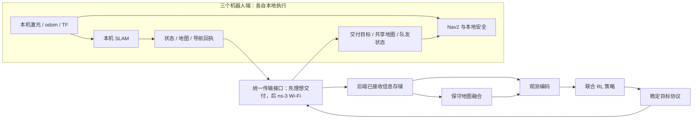

# MR3 研究路线：三机器人 RL 联合建图与冻结策略的 Wi-Fi 网络影响

版本：2026-10-14；路线标识：`MR3`。本文取代旧的目标搜索、充电、集合和通信调度 RL 路线。
唯一 Git 根：`/home/zhuyulab/ns3-workspace`。本轮只整理文档，运行代码未改变。
工程步骤、状态和逐步验收以 [IMPLEMENTATION_PLAN.md](IMPLEMENTATION_PLAN.md) 为准；
代码审计、文献和取舍依据见 [路线审计](report/20261014_mr3_route_audit.md)。

## 1. 研究问题与范围

研究对象固定为 **三台 TurtleBot3 Waffle**（`tb1/tb2/tb3`）。先在理想通信下，以一个
集中式 RL 策略联合决定三台机器人的探索子目标，复用本地 SLAM、地图融合和 Nav2；
随后冻结该策略，通过 gateway 将机器人与策略后端之间的上下行信息送入真正的 ns-3
Wi-Fi 分组网络，测量信息延迟、丢失和陈旧对同一联合建图任务的影响。

“去掉中枢控制器”在此指替换手工探索评分、分配和重派策略。用户描述的一个网络读取
融合地图并联合输出三台机器人动作，仍属于**集中式学习决策**，不是分散执行的 MARL。
允许保留导航协议、目标所有权和本地安全处理；它们不得偷偷替 RL 选择探索目标。

本路线只回答两个阶段的问题：

1. 在理想通信下，RL 能否在可靠导航和地图质量约束下，让三台机器人较快达到 95% 覆盖？
2. 在模型、观测定义和执行契约冻结后，真实 Wi-Fi 网络如何改变完成率、完成时间和安全表现？

通信优化、网络感知重训练、联合通信控制、硬件部署由用户以后另行确定，**不列入本轮路线**。
不增加目标发现、目标语义检测、充电、返航集合任务；不开展二、四、五机器人规模实验。
既有非三机器人配置和历史结果可以保留兼容性，不产生新的规模维护义务。

## 2. 当前实现与证据边界

| 项目 | 当前事实 | 新路线中的处理 |
| --- | --- | --- |
| ROS 2 / Gazebo / SLAM / Nav2 | 已实现；工程运行源码冻结于 `c9344e1` | 复用，三机器人契约在 MR3-P1A 验收 |
| `merge_map` | 公共坐标系的保守栅格融合；不是未知相对位姿的地图配准算法 | 保留融合规则，改变通信输入来源 |
| `control.py` | 手工前沿评分、分配、分段导航和失败处理 | 保留为对照；RL 模式必须与它互斥 |
| `peer_obstacles.py` | 直接读取所有队友 odom/TF，构造完整机体包络 | 网络阶段必须改成已交付信息或明确的本地感知 |
| Nav2 全局地图 | 三台直接读取实时 `/merge_map` | 网络阶段改成机器人端已交付地图副本 |
| 覆盖评估器 | schema v3，已有覆盖/质量/接触/截止/控制失败输出 | 审计任务区域、监测新鲜度和训练终止语义 |
| 三机器人导航 RL / 训练环境 | **尚未实现** | MR3-P1B 至 MR3-P2C |
| ROS 与 ns-3 双向 gateway / Wi-Fi 闭环 | **尚未实现** | MR3-P3A 至 MR3-P5 |
| `sim.cc` 与已有 DQN | 五用户、15 维观测、5 动作的 toy 调度 MDP | 历史工具链，不能充当三机器人策略或网络接入证明 |

现有最新三机器人证据仅是 seed 101、180 仿真秒上限、**90%** 覆盖的 rooms/corridors
工程回归，分别在 60.2/81.9 仿真秒结束，零接触。它不证明最新源码完成 95%，也不证明
RL、跨种子泛化或通信闭环。完整原件和失败见 [工程修复报告](report/20261013_p1c_engineering_repair.md)。
旧 P1C/P2C 编号、旧版本 PASS 和旧 toy DQN 成绩不得转记为 MR3 验收。

## 3. 推荐系统结构



真值评估、训练奖励和 ns-3 无线节点位置属于独立的仿真基础设施。其真值不能进入
策略观测、候选生成、动作掩码、目标派发或队友避障。机器人端可以持续使用本机传感器、
本机 SLAM 和本机 Nav2；后端只能使用通过统一传输接口交付的信息。

理想阶段就定义相同的信息信封、发送频率、缓存、源龄和动作契约，网络阶段只换传输实现。
不能先用任意实时 ROS 订阅训练，再在接网时改策略输入维度、导航规则或偷偷增加信息。

### 3.1 动作：首选稳定子目标，速度由 Nav2 执行

首版使用低频联合目标选择，建议起始策略周期 **1 仿真秒**。RL 输出三台机器人的
子目标选择、保持或等待；Nav2 继续负责路径与差速底盘速度控制。
这借鉴分层学习探索与经典规划结合的做法，不要求复制论文里的学习式 SLAM 或局部策略。
参见 [Active Neural SLAM](https://www.cs.cmu.edu/afs/cs/user/dchaplot/www/projects/neural-slam.html)
和 [NeuralCoMapping](https://arxiv.org/abs/2203.16319)。

首版动作空间的工程候选为：观测地图中几何采样的 **K=8 个前沿内侧可达子目标**，
每机器人再加 `KEEP` 与 `WAIT`，联合离散动作数为 `(8+2)^3=1000`。一个联合动作直接
编码三台的选择，避免把三个独立 argmax 当成联合策略。K 和周期在 MR3-P1B 根据候选
覆盖与吞吐验证后锁定，不能在网络对照中修改。

候选生成只做前沿几何提取、空间代表性采样、已观测空间路径/机体可行性检查与确定性
坐标转换。信息增益和路径长度可以作为网络特征；**不能先用旧控制器的效用排序挑好
目标，再让 RL 只确认它们**。记录候选截断、可达性失败、候选版本和掩码原因。
安全检查用原分辨率地图；CNN 的降采样结果不能用于判断细墙和窄门的可通行性。

目标稳定契约：

- 新目标的建议最短承诺为 5 仿真秒；承诺期内只允许保持，安全停止与终态例外。
- 承诺期后 RL 可以换目标，但必须先取消并确认旧目标终态，再发送新目标。
- 待接受、待取消、所有权不明时不能发送另一个目标；掩码限制为保持/协议安全动作。
- `KEEP` 不重复提交目标；`WAIT` 表示有界等待或经协议确认的停止，不能旁路写 `cmd_vel`。
- 每个目标带 episode epoch、目标 id、源观测版本、生成时间和有效期；迟到/重复消息幂等处理。
- 原 60 秒执行上限及 10 秒接受/取消期限是现有实现参数，新接口须明确区分本地 RPC 期限、
  网络命令租约及训练步长，先验证后冻结，不能按某次失败临时延长。
- 原旧控制器的效用评分、坏点回避重派、地图变化自动换探索目标，不作为 RL 模式的隐式后备。
  本地 Nav2 的已声明规划、避障和恢复仍可执行；每次安全介入必须有日志。

掩码由观测可行性、物理目标冲突和协议所有权决定，不使用真值或人工任务收益排名。
同一联合动作不能要求两台占据同一个冲突目标位置；必须总有合法保持/等待动作。
训练采样、概率计算和评估使用一致掩码；保存采样当时的候选及掩码，不能用后来的地图
重算旧动作的概率或 replay 含义。

直接速度控制不是首版主线。Waffle 是差速底盘，正确命令通常是 `(v, omega)`，不是可任意
侧移的 `(vx, vy)`。若以后比较直接速度策略，需要增加局部激光观测、高频控制、速度与
加速度约束、独占 `cmd_vel` 所有权及失联停止验证，应作为单独经用户验收的动作接口研究。

### 3.2 观测与网络

建议观测包含：

| 输入 | 内容与约束 |
| --- | --- |
| 融合地图 | 已知/未知、自由/占据分开编码；粗全局图加三台的局部裁剪；固定米制尺度与坐标变换 |
| 三台状态 | 同一公共 frame 下的 x/y、sin/cos yaw、实测线/角速度、状态有效位与源时间 |
| 导航上下文 | 当前目标、目标承诺龄、进度、接受/取消/终态、最近失败、目标所有权 |
| 候选 | 坐标、已观测路径长度、局部前沿几何特征、版本及有效掩码 |
| 历史与时间 | 有界已交付轨迹/目标历史、剩余任务时间；不会给网络真值轨迹 |
| 信息新鲜度 | 位姿/地图/回执的源龄、接收龄、缺失位、地图版本；理想阶段也保留这些字段 |

位置来自 SLAM/odom/TF 的估计。融合地图不是完整预先真值图，不能把未知格填成真实墙/自由空间。
静态共同初始 frame 是当前仿真的条件，不宣称解决任意初始坐标系的协同定位。
固定三机器人可先使用小型地图 CNN、共享机器人/候选 MLP 和联合 actor/critic。
可复现实装起点为128×128粗全局图与三份64×64局部裁剪、各自3个占据/自由/未知通道，
共享局部CNN与64维状态/候选特征，再由256维融合MLP输出1000类策略及一个团队价值。
这是待P1B验证的初始容量，坐标、裁剪边长和padding仅由观测/已声明任务边界决定；
不向编码器提供未探索墙体或真值可达mask。输入尺寸和参数量随契约一起冻结。
不因两块 GPU 而默认增加大型 Transformer；GNN/注意力只在三机器人协调或泛化诊断确有
不足时作为可审计的编码改进。首版为前馈策略加有界历史，避免未经验证的 recurrent+mask 组合。

### 3.3 算法选择与公平对照

| 方法 | 本路线的位置 | 需要区分的事实 |
| --- | --- | --- |
| 带动作掩码的联合 PPO | 主线；联合 1000 类动作，集中式 critic | PPO 是 on-policy；标准实现优先，先验证训练环路 |
| DQN / Double DQN | 同一离散动作接口的算法对照 | replay 必须保存候选/掩码；下一状态最大 Q 也要掩码 |
| SAC 或 TD3 | 有条件补充：连续局部目标偏移 | 与离散候选接口不同，只能称完整方法比较，不能归因于算法一个变量 |
| DDPG | 文献参考，不作为首轮必跑项 | 连续控制可以先评估 SAC/TD3，避免同时铺开所有算法 |
| MAPPO / 分散 actor | 本轮不需要 | 三机器人不自动等于 MARL；改变执行架构需另立问题 |

PPO、DQN 的同接口比较先于连续接口扩展；主线并不承诺 PPO 一定最好。
优先复用成熟 PyTorch/Gymnasium/Stable-Baselines3 生态，实施时锁定版本和 CUDA 兼容性。
[MaskablePPO 官方说明](https://sb3-contrib.readthedocs.io/en/master/modules/ppo_mask.html)
支持离散动作、Dict 观测和并行环境，但不直接支持 recurrent policy；评估必须使用对应
mask-aware 入口。不能把独立的 RecurrentPPO 与 MaskablePPO 当成直接可拼接的同一实现。
详细论文与限制在 [审计参考文献](report/20261014_mr3_route_audit.md#参考文献与核查结论)。

## 4. 任务、覆盖率与奖励

### 4.1 先证明 95% 的测量定义与可达性

主要成功条件为：三台均有效参与，任务截止前，后端**已交付融合地图**的正确自由空间
覆盖达到 0.95，满足冻结的地图质量界限、零真实接触、有效且新鲜的安全监测，以及闭合
的导航协议；不能用“没有前沿”或训练 reward 高替代成功。

当前真值由 SDF 静态 box collision 在激光高度栅格化，覆盖分母是碰撞几何外接矩形里的
全部自由格；尚无显式室内任务 ROI、机体可达性或激光可见性 mask。mesh及含roll/pitch的不支持
几何会被计数，未必被正确栅格化。因此旧 90% 结果不能推导 95% 一定可测或可达。
MR3-P1A 必须核查场景外部、封闭区域、窄缝、坐标与 unsupported collision，建立在训练
之前固定的任务 ROI 和地图真值。主要分母为该 ROI 内真实自由格；可达/可见性分析用于
说明任务是否合理，不得在模型失败后随意删掉未探索格。若场景本身不适合 95%，先修正
场景/任务定义并经用户验收，保留旧口径对照，不降低 95% 要求来制造 PASS。

任务上限的初始工程候选为 **300 仿真秒**，在 MR3-P1A 依据开发场景与实际吞吐预先确定，
在训练/正式测试前冻结。旧 90%/180 秒是工程证据，不是新 95% 的已验收预算。
地图质量至少报告已知区准确率、occupied IoU 和错误自由标记；质量门限须在 P1A 用正确
几何及基线预声明，不能在最终测试后选择。新口径需要独立 schema 与旧/新对照，历史原件不改。

网络阶段同时输出：

- `C_hub`：后端收到的信息所构成地图的正确自由覆盖，主任务依据。
- `C_physical`：评估器从机器人本地地图离线构造的同规则联合覆盖，仅作因果诊断。

物理已建图但尚未上传，与机器人尚未探索，是两种不同影响；后一辅助值不进入 actor 或后端缓存。

### 4.2 奖励草案与防止捷径

以任务时间为主要目标，使用稠密覆盖增量帮助学习，而不是只在 95% 时给一次稀疏奖励：

```text
r_t = w_c * new_correct_free_fraction
      - w_t * delta_sim_time / T_max
      - w_collision * actual_contact_event
      - w_switch * discretionary_goal_switch
      - w_invalid * invalid_or_rejected_action
      + success_bonus * terminal_success
      - failure_penalty * terminal_task_failure
```

`new_correct_free_fraction` 对冻结真值格按首次正确识别记账，不能重复领取地图
未知/自由翻转、不同机器人上传同一格、地图重发或回环修正带来的重复收益。
终态仍用当前地图的真实覆盖和质量，历史首次奖励账不能代替当前地图质量。
默认奖励在训练端读取后端地图对应的覆盖；真值只在隔离的训练奖励/评估器进程里使用，
不出现在观测、候选、掩码、checkpoint 推理输入或部署接口中。

初始权重用开发数据做尺度校准并锁定，保证失败/碰撞不能被小幅覆盖收益抵消。
可用的首轮数值草案为 `w_c=10, w_t=1, w_collision=20, w_switch=0.01,
w_invalid=0.05, success_bonus=10, failure_penalty=20`；覆盖增量为0–1归一化分母，
动作切换/拒绝按实际次数记，任务失败与接触罚项可以同时发生。验证总覆盖收益上界、
死亡捷径及时间项尺度后才锁定，不将这一草案称作已经有效的奖励。
碰撞罚分不等于安全证明；实际碰撞使该任务不满足成功门禁。
不奖励无意义移动、重复扫描或通信吞吐，不在当前阶段加 AoI 优化/通信调度奖励。
前沿耗尽且未达 95% 明确记录不完整，不能提前宣布成功。

首版固定策略步长，Nav2 在多个步内执行同一目标。终态不足一个步长时奖励按实际
`delta_sim_time` 计；若采用事件驱动不等时长 step，必须同时修改折扣与优势计算为
时间一致的 SMDP 形式，不直接套固定 gamma 的库实现。
任务自身的有限截止属于失败终态，观测含剩余时间；采样器外部截断才是 truncated，
两者的 bootstrap 区分按 [Gymnasium 官方说明](https://gymnasium.farama.org/tutorials/gymnasium_basics/handling_time_limits/) 验证。
基础设施崩溃单列原因，不能被当成正常“成功终止”或悄悄丢弃。

## 5. 训练工程与理想通信验收

ROS 节点用系统 ROS 2 Humble Python；学习端用 conda `ns3gym` 的 CUDA PyTorch，
保持 `PYTHONNOUSERSITE=1`。采用显式本机 IPC/进程边界，避免通过拼接 PYTHONPATH
强行把 ROS 与 conda 混在同一解释器。IPC 不模拟网络；以后只有网络交付端可写后端信息存储。
新训练环境使用独立 MR3 schema，不修改 toy MDP 来冒充机器人环境。

训练之前先量测 Gazebo real-time factor、reset/startup、每秒有效策略 transition、CPU/RAM
及 GPU 利用率；比较 1/2/4 个**并行三机器人环境**的吞吐。这不是机器人数量扩展。
每 worker 有独立 ROS_DOMAIN_ID、Gazebo master、端口、进程组、episode epoch 和输出目录。
先采用完整进程重建的可靠 reset，再有证据地优化；只重置 Gazebo 位姿而残留 SLAM、
代价图、动作 Future、地图缓存、RNN/历史状态和终态账本，属于无效训练。

两张 4090 不保证 Gazebo 采样快。可让一张训练、另一张进行独立种子训练或验证，但共享
CPU 预算和 PPO 采样策略版本必须明确；首版不强制 DDP。若采样成为实测瓶颈，可以在
单独验收后使用快速二维模拟预训练，保持动作、局部感知和奖励口径，并在真实 ROS/Gazebo
微调和正式测试。快速环境不能用全真值地图给 actor，也不能替代最终物理导航证据。

开发数据可使用已有 my_world/open/rooms/corridors 和 101/202/303；这些是已知开发
场景/种子，不再称为留出。正式泛化需要预声明的未用于调参的布局与起始姿态/传感器种子，
只改随机 seed 的同一布局不能证明跨布局泛化。所有布局使用固定三机器人。

算法比较至少三条独立训练种子曲线；预算允许时五条。报告 transition 数、累计仿真秒、
墙钟训练时间、调参次数和共同测试预算；按验证集选 checkpoint，测试集只做最终评估。
正式矩阵建议每种方法至少三种未见布局、每布局十个任务种子；在 P1A/P2B 根据吞吐
预声明确切清单，pilot 与正式结论分开。资源不足时报告试验性结论和不确定性，不能
把单次最好曲线称为统计胜出。

比较对象为旧前沿控制器、同候选接口的几何贪心分配、联合 PPO、同接口 DQN。
旧控制器原生规则与统一候选接口基线分别标注；除全局策略外保持 SLAM、Nav2、机体、
传感器、目标稳定/安全契约与任务口径一致。不可同时换地图融合/导航参数再将收益都归因于 RL。
验收“运行不错”应至少达到预声明测试矩阵中 95% 任务的 90% 成功率、正式验收矩阵零真实接触及
无隐式旧控制器兜底；更快这一主张需要失败计入的时间统计支持，不能只平均成功子集。
若可靠运行但没有显著快于强基线，应诚实报告，不为接网阶段制造 RL 最优主张。

理想通信阶段结束时冻结权重 SHA256、归一化统计、编码/候选/掩码版本、动作接口、
调度周期、Nav2/SLAM/安全参数、地图规则、随机种子及推理模式。
网络阶段不重训练、不改 reward、不换模型、不在线更新归一化，不增加新的策略输入。

## 6. Gateway 与真实 ns-3 接入

### 6.1 应用信息边界

| 数据 | 上行/下行 | 接收端可以使用什么 |
| --- | --- | --- |
| 位姿、实测速度、frame 变换摘要 | 机器人 → 后端 | 最近完整交付的状态和原始时间戳 |
| 本地地图快照/增量 | 机器人 → 后端 | 已重组且基版本匹配的地图；缺增量则等待完整恢复 |
| 接受/取消/导航结果、健康与心跳 | 机器人 → 后端 | 已交付回执；不能直接访问远端 action Future |
| RL 目标、取消、租约续期 | 后端 → 机器人 | 未过期且符合 epoch/id 的命令，由本地 action proxy 执行 |
| 融合地图副本、队友状态 | 后端 → 机器人 | 已交付共享信息；不能读取后端实时 `/merge_map` 或队友 raw TF |
| 激光、IMU、本机 odom/TF、低层 `cmd_vel` | 本机内部 | 保持本地，不假装走远端 Wi-Fi |
| Gazebo 真值、碰撞原件、无线节点真实位置 | 评估/无线仿真内部 | 仅评估或传播模型；不得反向更新策略信息 |

机器人端导航地图应采用**本机最新 SLAM 与最后收到的共享地图**的声明式融合副本；
理想模式和网络模式使用相同规则，避免将接网退化混同于换规划地图。
名称如 `/tbN/navigation_map`、`/received/...` 是拟定接口，当前代码尚未提供这些 topic。
当前 raw `/merge_map` 静态层和 raw 队友 odom/TF 避障必须在 P3A 消除旁路。

可使用独立机器人/后端 DDS 域或隔离进程与订阅白名单来建立边界；仅改 topic 名称不足以
证明隔离。黑断测试时，即使 raw ROS 数据继续产生，后端位置/地图不得继续变新，远端
目标和共享地图也不得到达。记录所有跨边界读写与交付链，审计单纯结果回调、TF 查询、
RViz 目标、评估器以及 safety 模块造成的旁路。

安全信息也受通信边界约束。当前 peer 组件源龄超过 0.5 秒会锁存失败；接网前须把网络
陈旧的有界停止/租约处理与真正导航协议失效明确区分，并在理想模式预先验证。
允许按已交付位姿、最大速度和源龄构造保守队友可达包络，或经验证的本地感知；
不能以“安全”为由继续使用实时全体真值/odom，也不能为制造或避免退化而移除机体、
缩小包络或关闭碰撞监测。源龄过大导致暂停、超时或失败是可报告的网络影响。
本地 Nav2 避障可能使碰撞仍为零；不要预设接网后一定出现碰撞。

### 6.2 字节、顺序与协议

应用信封至少包含协议/episode 版本、发送/接收 robot id、序号、源传感时间、编码时间、
地图 frame/版本/基版本、目标 id/租约、长度、分片信息与校验。
记录生成、入队、实际发送、网络接收、重组与应用时间，不用接收时间重写传感源时间。
AoI 分开记录原始感知源龄与消息编码源龄，不能把旧地图重新发布后称为新鲜。

地图、状态和命令的实际序列化字节进入 ns-3 `Packet`，经应用 socket、IP、Wi-Fi
MAC/PHY 传输，只有完整接收、校验与重组后的内容可写接收缓存。
只传一个 id/虚拟包长、收到 id 就查旁路的最新 ROS 对象，不能证明应用数据经过网络。
应用字节、压缩字节、分片/IP 开销、MAC 重传与 airtime 分层记账，不重复计算。
地图压缩/增量语义、发送周期、队列优先级与重试策略在理想训练前定义，模型冻结时
一并锁定，并对所有传输模式一致；P3A补全字节实现时必须验证语义/频率等价。
初始候选可为状态 10 Hz、地图 1 Hz、导航心跳 5 Hz；最终由实测数据源频率/大小与
任务需要在 P1B/P1C、训练开始前确定，不在接网后改发送频率制造差异，
不生成填充流量假装真实 SLAM 负载。

丢片不提交部分地图；增量缺基版本不能应用；旧版本不得覆盖新版本。
命令 ACK 丢失时用同 id 重试/查询，不能再次创建目标；取消与结果丢失时保留未知所有权。
乱序、重复、跨 episode 迟到、过期命令以及 outage 后恢复均需独立夹具验证。
受控 delay/drop 插件是协议测试，不等于真实 Wi-Fi 试验。

### 6.3 无线模型与时间耦合

拓扑先固定 **1 AP + 3 STA**。AP 与 RL 后端逻辑同址，STA 与三台机器人关联。
默认工程候选为 802.11n、20 MHz、固定可追溯速率设置；频道/功率/MCS、MAC 队列、
聚合/重试、传播/误包模型和 AP 位置在 P4A 依据版本 3.40 与测量冻结。
不照搬旧路线的二 STA、虚拟五用户调度或强制双干扰 BSS。

无线节点位置可由 Gazebo 真值驱动，这是传播仿真的真实位置输入，不是后端观测。
室内墙损耗、距离衰减及背景负载需有明确假设和参数来源；几何墙体不会自动成为 Wi-Fi
传播障碍。采用适合所声明干扰范围的 Yans/Spectrum 模型并报告限制，不能以 Wi-Fi
标准名称代替实际 PHY/MAC 配置。健康链路、遮挡/距离、竞争负载三类条件先校准再锁定。
若实际负载远低于信道容量且未出现退化，这也是有效结果，不能临时塞入未声明干扰追求显著性。

**时间耦合是独立验收门禁。** ROS `/clock`、Gazebo 与 ns-3 使用同一 episode epoch 的
逻辑仿真时间；ns-3 `t = ROS_sim_time - episode_t0`。不能把墙钟 sleep 延迟当成
仿真链路延迟，也不能认为启动 `RealtimeSimulatorImpl` 就自动同步两个模拟器。
[ns-3 RealTime 官方说明](https://www.nsnam.org/docs/manual/html/realtime.html)及本地 3.40 手册
说明它对齐的是机器墙钟，负载过高时存在落后/中止行为。

首选评估 Gazebo 物理多步推进与 ns-3 分段事件推进的有界屏障，建议初始耦合量子
20 ms，验证 10/20/50 ms 的敏感性；ns-3 内部保留精确事件时刻。
ROS SLAM/导航回调与物理步并不天然同步，必须记录屏障、消息水位、同刻事件次序、
量子造成的额外交付延迟及可重复性。位置更新不使用未来轨迹；控制输出、地图版本、
动作结果与网络接收必须遵守因果顺序。
如果该栈无法可靠锁步，先单独审计可实现的协调方案；未验证实时耦合只能算演示，
不能跳过门禁提供正式任务结论。重放流量能验证网络组件，不能代替运动与网络相互影响的闭环。
现有 ns3-gym 可复用部分 IPC/事件交互经验，但并未提供现成 ROS gateway 或自动时钟同步。

## 7. 冻结策略的网络实验与最终交付

按同一策略、同一观测/导航契约、同一场景/启动姿态/任务种子配对比较：

1. 原理想通信接口；
2. gateway 的理想直通：验证适配本身未引入旁路或行为变化；
3. 受控延迟/丢包：归因工具，不计真实无线信用；
4. ns-3 健康 Wi-Fi；
5. 已预声明的受限 Wi-Fi 条件，独立网络种子重复。

必须先通过直通等价与交付审计；若适配改变了策略输入或执行规则，返回早期接口验收，
不能一边改环境/策略一边把差异归因于 Wi-Fi。网络实验期间模型与归一化完全只读。

主要指标：95% 完成率；包含失败的时间指标（成功用 T95，失败以 T_max 计并单列类型）；
成功条件下 T95 分布；当前终态覆盖、地图质量；真实接触数量/持续时间；安全停止、
目标切换/拒绝/取消、有效运动和路径长度。截止检查优先于覆盖判断。
网络指标：实际上下行字节、端到端时延分位数、AoI、有效地图版本、队列/分片丢失、
MAC 重试、命令到达/执行龄、回执闭合率及时间耦合误差。
中心轨迹重复率不是重复建图面积；如要报告后者，另定义基于传感可见格的统计。

报告配对差值与置信区间，按布局、任务种子、训练种子区分重复层级；不能把一个模型的
很多测试 episode 当成很多独立训练结果。保留每次尝试和基础设施失败，区分任务失败
与无效测量，不把策略诱发的握手/死锁失败删掉。实验结论可以是下降、无显著变化或
特定条件下的安全停止；不能事先要求网络一定有害。

最终交付为：可复现三机器人 RL 理想任务、冻结策略/契约清单、真实 Wi-Fi 双向闭环、
无旁路/时钟/字节证据、完整包含失败的网络影响报告。到 MR3-P5 用户验收为止。
后续解决网络影响的方法与实机路线暂不规划。

## 8. 文档、状态和实验纪律

各子步骤均先实现最小可审计闭环、完成相应测试并提交推送，再给用户验收；
**用户确认该子步骤后才开始下一子步骤**。发现基础问题先修根因，不叠加按场景/种子命名的
分支，不放宽评估分母、机体、安全或时间门限，不把不同提交的最好格拼成一张矩阵。
方案调整可以发生，但需更新契约版本、说明影响、重新验证受影响步骤。

规划文档写当前契约与状态；方法依据留在路线审计；实验原件和详细时间线集中在
[log.md](log.md) 与日期报告。[报告索引](report/README.md)和
[归档索引](report/ARCHIVE_INDEX.json)明确历史内容的适用版本。
旧报告保留数据，只作为历史证据，不指挥新工作；原路线最新完整版留在
`p2c1/global-mission-20261012@8fe1495`，当前 MR3 在 `main`。
