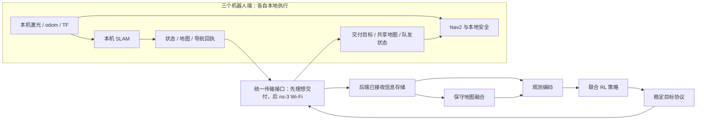

# MR3 研究路线：三机器人 RL 联合建图与冻结策略的 Wi-Fi 网络影响

2026-10-24 V61实际闭合描述性PASS：执行freeze282e5fa61、旧证据E935b466bd，tool59189真实reap rc0；五原件单pass523777922B、parse0、3898选行/0drop/缺依赖0，不证明根因、物理修复或资格。25 runtime源/16旧E解释源及30含配置引用稳定，3已保存main PID/start freshgone；late ancestry observer未保存rtk/shell原start，外transport库存不完整，绝不claim全树gone。完整parent实费38.102415614，累计108886.5066566616018/C150000、余41113.4933433383982，nested/root工具墙时不叠加；pilot/final原额保持。44 regular原件73370260B无损封存8725840B、0link；metadata13.011257211s/archive17.368586778s真实CPU关闭，4 CPU身份另gone、工程新增0。capacity=False、P2A未完成、禁auto pilot/final。先执行独立 A62 八步性能 baseline，cancel authority 仅在 /tmp 并行设计，避免修复混淆 baseline 成本；随后取消修复与 probe-v2、实测等价优化、capacity gate、新同 freeze 完整 12 EP / 30 角色、真实学习及三场 strict95。 用户持续自主授权保持，不重复一般审批。 见[V61实际闭合](report/20261024_mr3_p2a_v61_cancel_forensics.md)与[规范末账](report/assets/20261024_mr3_p2a_v61_cancel_forensics/closure_ledger_v1.json)。下方日期准备与旧结果保留历史范围。

2026-10-23 V60实际闭合FAIL：执行冻结`935b466bd076002afdfe161b55a508938de2a8b0`，tool30588真实reap rc1；原生11EP/296返回，30必要角色为19PASS/1FAIL/10SKIP，minimum/pilot/final未启动、0学习。reset worker1/episode002 open101的tb2存在真实B停车超限：native cancel42.86→rest45.891，3.031秒/约.25933m；两worker的episode004 corridors101中tb3均缺有意义的native cancel停止证据。覆盖缺口与真实超限分别保留，不能用改probe覆盖宣称取消链已修复。1029源/10ELF一致，548份已保存runtime owned身份freshgone；metadata tool25900真实rc0/8.790793906秒，其2身份另gone。archive tool77857真实rc0/542.506088964秒，5071 regular原件10,444,431,903B无损封存为877,999,890B，0link、无>64MiB单文件、无overlay。完整工程parent union实费14531.744949156秒，累计108848.4042410476018/C150000、余41151.5957589523982；nested不重复加，pilot/final本次0且原余额不变，150000为代理依持续委托前瞻选择、非逐数值用户批准。见[V60实际闭合](report/20261023_mr3_p2a_v60_reader_registration.md)与[规范末账](report/assets/20261023_mr3_p2a_v60_reader_registration/closure_ledger_v1.json)。

当前capacity gate=False，禁止自动进入pilot/final。V61固定窗描述已闭合，原V60停止超限和两corridors缺取消覆盖未获修复信用。先执行独立 A62 八步性能 baseline，cancel authority 仅在 /tmp 并行设计，避免修复混淆 baseline 成本；随后取消修复与 probe-v2、实测等价优化、capacity gate、新同 freeze 完整 12 EP / 30 角色、真实学习及三场 strict95。 每次新活动须独立scope/资源/CPU/新冻结；A62八步baseline不提供停止覆盖、整回合容量或资格信用。R/5秒承诺/32step/12EP30/95%门和历史FAIL保持。

2026-10-23 V60生产准备：sensor唯一显式profile tag全字节逆恢复与peer两新事件/同plan三drive compound/APPLIED精确join已接公共full/PPO/controlled/4matrix/3policy；不删行或伪zero，C++/物理/actor/20build输入不变。canonical targeted159、fresh ROS202/learner437、编排13实际PASS/source稳定，原fixture/兼容失败保留，尚无V60World/资格/PPO。承接V59真FAIL账94316.6592918916018/C150000、余55683.3407081083982，拟47220完整工程预约；pilot/final与R/12EP30/95%保持，150000非数值用户批准。source a03b9c530已真推送，新plan1029源/10ELF及12EP30/readiness实际通过；下一最终执行freeze与严格准入/完整链，不借旧6PASS。P2A未完成。 见[V60](<report/20261023_mr3_p2a_v60_reader_registration.md>)；下方为历史快照。


2026-10-23 V59实际闭合FAIL：freeze783aec553、tool53492真实reap1；原生1EP32/32rc0，必要角色6PASS/1FAIL/23SKIP，full与无role fifo子命令失败，后继资格/学习0。静态定位新SDF profile tag逆投影及peer两类新事件白名单登记遗漏；V60补显式登记/公共入口CPU，旧FAIL不改。parent scope union2099.471611454，累计94316.6592918916018/150000、余55683.3407081083982；pilot/final原额保持，150000为代理持续委托选择非数值用户批准。1015源/10ELF一致、67完整保存运行身份freshgone，2transport祖先nonowned及PID-only原未知保留；关闭CPU4身份另gone。578原件1.11GB无损封存97.84MB/0link。P2A未完成；下一新freeze完整12EP30→真实更新→三strict95，不重开旧活动。 见[V59实际闭合](report/20261023_mr3_p2a_v59_encoder_profile.md)；下方准备为历史快照。


2026-10-23 V59生产准备：新Reach自动固定initial-zero-encoder-hold-v1，genuine初始zero后一次q_ref，首成功非零receive永久退出，APPLIED/实际纠偏真实披露；新驱动实际build及4接收回归通过。独立motor62、build/profile/cadence83针对CPU通过，最终fresh ROS202/learner411及编排11项实际PASS/source稳定，旧fixture/入口/source-drift失败保留。source/build冻结ec63e5946已真实推送，1015源/10ELF完整计划、12EP30roles与双环境readiness实际通过；尚无V59 World/资格/PPO，下一封执行冻结B、严格newbuild/binding后完整同freeze链；旧V15资格不借、R/12EP30/95及原pilot/final保持。V58旧账92217.1876804376018承接，代理持续委托下前瞻选C150000（非数值用户批准）、余57782.8123195623982，拟47220工程预约。P2A未完成。见[V59](report/20261023_mr3_p2a_v59_encoder_profile.md)；下方为历史快照。

2026-10-23 V58实际闭合描述PASS：freezeb6af48cfe、tool23554真实reap0，355000步/355sim秒、三机固定anchor最大位移约7.56446e-6m，R=.0078/一次body anchor保持；真实非零motor纠偏完整保留，仅隔离候选取样，不供生产/连续证明/学习或95%信用。parent899.40726088已收，累计92217.1876804376018/120000、余27782.8123195623982；4已保存main及2关闭CPU身份gone，20原件无损封存，push回收观察晚于native提交的次序透明保留。下一S59生产新profile/newbuild/独立compound-law及新同freeze完整链，代理前瞻选择150000有限工程块（非数值用户批准），余57782.8123195623982、拟预约47220，scope待实现CPU封存；pilot/final及历史FAIL保持，P2A未完成。见[V58实际闭合](report/20261023_mr3_p2a_v58_encoder_hold.md)；下方准备状态为历史快照。

2026-10-23 V58禁用候选准备：只对首次非零请求前的初始静止阶段设计本地轮编码器P保持，参考捕获一次、首次非零永久退出，实际非零电机纠偏完整披露；未接生产、未运行World。helper12组、driver末轮6组CPU与真实native编译通过，source/spec已准备，待新exact40freeze及一次正式诊断，不借旧actuation恒等或V15 no-new-build信用。承接V57累计91317.7804195576018/120000、余28682.2195804423982，新单quick150诊断拟预约2100（work1500/outer1800），原R=.0078/一次anchor、12EP30角色/95%及pilot/final保持。见[V58预声明](report/20261023_mr3_p2a_v58_encoder_hold.md)；下方V57“仅静态评估”为当时闭合快照，P2A未完成。

2026-10-23 V57实际闭合FAIL：freeze71cb6b180、tool92392真实reap rc1。独占HOME后两臂均进入实际物理运行；quick150 rc1/partial235.631sim秒，600秒合作式上限，三机固定anchor最大位移约.007351365m仅覆盖已观测部分，不证明完整310秒hold。direct-world rc0/COMPLETE355sim秒，但三机位移4.092486/4.415539/5.779568m、最大平移速度约3.60–3.79m/s，物理候选严重失败，不支持direct solver接生产；执行完成与物理可用分开。目标0不等于每次反馈slew输出命令0，实际命令/CSV完整保留；R=.0078及一次固定anchor不变。连续pair parent935.226829603墙秒含gap、nested不加，累计91317.7804195576018/120000、余28682.2195804423982；120000仍为代理依持续委托选定，非逐数值用户批准。372原源前后稳定，关闭新核30非库/28repo current-Git及old10，342库不重读；仅6份实际保存main身份gone，关闭CPU两轮4身份另gone。28 regular原件32763601B→12859498B无损封存，另1个Pulse链接只存lstat/字面目标、不跟随外部目录。关闭CPU首轮拒绝该链接原件保留，后轮PASS/28.583849962墙秒、工程0。下一仅本地轮编码器zero-hold有限servo的静态评估，尚无新科学版本/生产应用/native；不改R、刷新anchor、隐藏非零命令或重开旧活动。pilot/final及12EP30角色/95%安全门和历史FAIL保持，P2A未完成。 见[V57实际闭合](report/20261023_mr3_p2a_v57_passive_plant.md)、[库存](report/assets/20261023_mr3_p2a_v57_passive_plant/closed_inventory_v1.json)及[末账](report/assets/20261023_mr3_p2a_v57_passive_plant/closure_ledger_v1.json)。下方准备/待执行文字保留为历史快照。

2026-10-23 V56实际闭合诊断PASS：freeze9d2229010、tool8209真实reap rc0，已取得inferior SIGSEGV栈；GDB rc0不表示inferior自然退出或有效物理结果。主栈strlen→DiagnosticManager构造→World::Init→loadWorld；本机ELF反汇编与实际返回地址共同定位缺HOME的无空检查strlen路径，原V55 FAIL不改。实际parent12.268341836墙秒（含post-source/owned cleanup，nested不加），累计90382.5535899546018/120000、余29617.4464100453982；120000仍为代理受持续委托选择，非用户逐数值批准。376条原源before/after稳定；关闭仅新核34非库源/30 repo current-Git及旧10子集，不重读342库；6主身份freshgone。12小原件586647B→516957B/0link无损封存；关闭CPU v1别名metadata拒绝原件保留，v2真实PASS/26.171658586墙秒、工程0，两轮各2身份另gone。生产p1c基线是quick150，quick50仅旧诊断；无资格/学习信用，pilot/final和科学门保持，P2A未完成。 见[V56实际闭合](report/20261023_mr3_p2a_v56_startup_gdb.md)和[规范末账](report/assets/20261023_mr3_p2a_v56_startup_gdb/closure_ledger_v1.json)；下一步仅按[V57新声明](report/20261023_mr3_p2a_v57_passive_plant.md)修启动环境后作有界quick150/direct-world比较，不重试/改判旧V55，不承诺solver或安全结论。下方准备及待执行文字保留为历史快照。

2026-10-23 V55实际闭合FAIL / V56单次启动栈诊断准备：freeze63f5cc107的tool23231真实reap rc1，两臂CPP均-11、wrapper1，早期身份保存但summary缺失，无有效物理结果；HOME/ALSA/OpenAL提示不归因。连续parent12.924178319墙秒已收，累计90370.2852481186018/120000、余29629.7147518813982；6主保存身份及metadata CPU自身2身份分别gone，关闭CPU真实wall9.076326329秒/工程0。配置解释更正：实际生产p1c_*.world是quick150，A55 quick50是诊断设置，不能称生产原配置；loadWorld已有Init，不据无栈假设补Init。V56仅同未改A55 ELF+quick50 World取一次SIGSEGV栈，GDB12.1 batch/noinit、关闭auto-load/debuginfod、timeout120，driver150/180仅owned pidfd退出兜底，完整parent新预约300，不宣称硬实时；旧A55字节准入仅核371链，不调用旧run_case或沿用旧预算。spec/CLI/source CPU由root最后封存、尚未执行；V55不重跑/改判，pilot/final及科学门保持，P2A未完成。 见[V55闭合](report/20261023_mr3_p2a_v55_passive_plant.md)及[V56预声明](report/20261023_mr3_p2a_v56_startup_gdb.md)。下方准备状态保留为历史快照。

2026-10-23 V55零驱动物理诊断准备：native CPP/generator已规范安装，三轮真实CPU编译PASS（51.086935907/50.734880339/47.164755331墙秒），仅末轮代码/ELF适用，旧轮原件与prepared_worlds_v1/v2/v3保持。末版补首末UpdateEnd时钟/观测数及显式physics->SetSeed(101)，不伪称ODE种子readback。driver三轮各6人工CPU实际PASS（末轮.293310886墙秒）；清洁运行环境显式绑定现有ROS native依赖目录，最终loader PASS/.061848255墙秒且342对象/SHA均与build一致，旧loader两库选择差异与全部回执保留，均无World；manifest首轮whole-stat断言FAIL保留，改稳定字段集合后封存，不断言已知哪个字段变化。正式尚未World：1800连续pair parent预约含两臂间gaps，case coop600、720仅自身退出及10/10升级；3机45s settle+310s hold、1ms物理步/34ms电机更新，限定quick50/world因果隔离，不是旧EP exact replay、18stream安全或资格证明。累计90357.3610697996018/120000、余29642.6389302003982不变，pilot/final原额及科学门保持。执行须新exact40freeze，保留partial/真实rc/全费FAIL、不重试；P2A未完成。 见[V55准备](report/20261023_mr3_p2a_v55_passive_plant.md)。下方先前状态保留为历史快照。

2026-10-23 V54真实闭合描述PASS：freeze1d35dda0的tool36067已reap rc0，motion1086363行/2458997272B与startup460行/286052B均全读、整SHA/stat/parse0通过，40选择/0drop。首登记故障为tb1在244.58秒normal_control_model_invalid / fixed disk radius exceeded；D是固定anchor圆盘，不是仍处于HOLD的状态判据，literal本身也不证明真实机体违反物理界。完整parent254.441556546墙秒（nested不加），累计90357.3610697996018/120000、余29642.6389302003982；4主身份freshgone，metadata关闭17.468819143实际wall/工程0，其2身份另gone。原live观察误取argv索引2为--freeze，原字节和三SHA更正说明保留，不改身份。V52/V53旧FAIL与实费、12EP30角色/95%安全门及pilot/final原额保持；120000仍为代理依持续委托选择而非数值用户批准。下一仅转向固定KEEP故障的零驱动物理诊断，尚无新scope或solver成功承诺，不改变科学门，P2A未完成。 见[V54闭合](report/20261023_mr3_p2a_v54_firstfault.md)及[规范末账](report/assets/20261023_mr3_p2a_v54_firstfault/closure_ledger_v1.json)。下文既有准备/待执行段均保留为当时历史快照。

2026-10-23 V53闭合partial FAIL / V54准备完成：V53执行freeze7f122cfd3实际rc1，motion在1,000,001行触及固定行数门，仅读2267972220/2458997272B，首生产故障仍UNKNOWN_PARTIAL_PARSE；startup全460行/SHA通过，仅记录worker自身infrastructure_failure回调，不能冒充producer首fault。完整parent实费229.413776461墙秒（nested不加），累计90102.9195132536018/120000、余29897.0804867463982；4主身份及2后继CPU身份分别freshgone。V54只前瞻改资源/版本：同两原件、epoch/窗口/选择规则与旧七解释源，每文件200万行、work480/完整parent600墙秒；候选21项/.170796105、规范21项/.375278637实际wall通过，18绑定源稳定、规范CPU两身份gone，首轮setup失败保留。尚待新commit/push后的exact40freeze正式一次取证；V53不补读/改判，原12EP30角色/95%安全门及pilot/final余额不动，120000为代理依持续委托选择而非数值用户批准，P2A未完成。 见[V53闭合](report/20261023_mr3_p2a_v53_firstfault.md)与[V54预声明](report/20261023_mr3_p2a_v54_firstfault.md)。

2026-10-23 V52闭合FAIL / V53取证准备：冻结1fa55bc56的interface9、terminal6、reset9必要角色PASS；deadline 203完整步后第204步normal_control_model_invalid基础设施失败，6类审计未派发，无minimum/pilot/final。4父区间实费19330.328322094，累计89873.5057367926018/120000，余30126.4942632073982（120000为代理依持续委托选择，非数值用户批准）；933源/10ELF稳定、611保存身份gone。7772原件15.63GB无损归档，两个大gzip按64MiB精确分块、原库存/字节保持。V53仅预约300工程秒，固定两日志/244.48–244.62s首次故障描述，21人工CPU及规范安装通过；尚待新冻结实际一次取证。原FAIL、政策余额和科学门保持，P2A未完成。 见[V52闭合](report/20261023_mr3_p2a_v52_qualification.md)与[V53预声明](report/20261023_mr3_p2a_v53_firstfault.md)。

2026-10-23 V52准备：显式reset reader登记与runtime声明/ACK索引、严格JSON构造等价优化已接入；候选10项、初轮81项、新resource v3集成297项人工CPU通过，原数学/物理/95%及12EP/30角色保持，尚无新native/学习。代理按用户自主持续委托前瞻选择工程累计120000（非声称数值user批准），从原账70543.1774146986018承接、余49456.8225853013982，预约47220；pilot/final原额不动。四入口10case与真实prepare/plan_check已通过，933源/10ELF待新冻结执行，旧FAIL保持，P2A未完成。 见[V52](report/20261023_mr3_p2a_v52_qualification.md)。

2026-10-23 V51闭合PASS：freeze41100004固定旧V50单open回合原runtime审计1次完整PASS/无batch，parent421.403520124秒；24旧证据源/9执行源与Git一致、5保存身份freshgone，22原件362085B无损封存362008B。实际热点为JSON解析/规范化及重复声明/ACK全扫，非单纯几何；先等价索引/严格JSON构造CPU，再显式reset接线与原生阶段wall分解。累计70543.1774146986018/75000、余4456.8225853013982，pilot/final不动，无新资格/学习/95%信用，P2A未完成。 见[V51闭合](report/20261023_mr3_p2a_v51_runtime_profile.md)。

2026-10-23 V51准备：固定V50 reset首open回合的一次独立runtime profile，14输入/24旧证据源/9执行源封存，6组真实toy生命周期CPU及guard/driver模块help PASS；尚未原件消费。预约840主＋60尾＝900工程秒可funded，先实测再恒等优化/显式reset登记与新完整资格。用户持续委托保持，后续有界工程块按实测自主规划、诚实保留旧账及pilot/final原额；P2A未完成。 见[V51](report/20261023_mr3_p2a_v51_runtime_profile.md)。

2026-10-23 V50闭合FAIL：freeze23e909380真实reap rc1；11EP/296原生返回，30必要角色18PASS/2FAIL/10SKIP。reset input/runtime/full PASS，angular/physics旧probe入口拒绝、阶段11302.772605716>最终cap6301.463804643；可选两corridors停车证据缺口保留。deadline/minimum/pilot/final未启、0学习。911源/10ELF一致、545保存pair freshgone；5070原件10224871773B无损封存855260558B/0软链。工程parent union14162.168963343，累计70121.7738945746018/75000、余4878.2261054253982，pilot/final不动，P2A未完成。 见[V50闭合](report/20261023_mr3_p2a_v50_qualification.md)。

2026-10-23 V50准备：PPO按本epoch/versioned永久Reach fault在targets/train前拒绝，旧literal与正常任务负样本保持；新47针对CPU、8分类/模块help、双环境readiness及计划生成/校验PASS，V49其余CPU仅按源相等兼容。911源/10ELF、新同freeze完整12EP/30角色→minimum16→pilot请求上限64→final三open401/402/403 strict95%已封存，尚未native/PPO。更紧工程预约18220=matrix16000+minimum1800+external300+preflight120，入场55959.6049312316018/75000、余19040.3950687683982；pilot/final原总额保持，不保证64样本或95%，旧FAIL保留。用户自主持续授权保持，P2A未完成。见[V50](report/20261023_mr3_p2a_v50_qualification.md)。

2026-10-23 V49启动诊断闭合PASS：freeze14719a72b96cff65b134b7d46ec6d2ccbf84e061，两worker各rooms101/1真实step，2/2返回、2正常关闭，独立journal254/294行均完整。真实release为37.0/35.58sim秒且四项均ready；本次pause时motion已True，不冒充原生强制False回归。874源/10ELF一致，91保存身份含2原暂排祖先均freshgone；271原件497827640B无损封存38177415B/0symlink。完整parent212.565365239秒，工程累计55959.6049312316018/75000、余19040.3950687683982，pilot/final不动，P2A未完成。仅启动诊断、不填12EP/30角色；下一新V50先PPO新故障schema preupdate准入修复/相关CPU，再完整同freeze资格与学习链，用户自主授权保持。见[V49闭合](report/20261023_mr3_p2a_v49_startup_protocol.md)。

2026-10-23 V49准备：Reach启动改为真实上游3就绪→暂停→全零takeover/storage→原20ms bootstrap→精确ready状态及实际四ready→release，420秒绝对截止及清理剩余时限保持；首永久fault真实传播，数学恒等提速已集成。第二轮857人工代码检查＋13检查器自检及双环境readiness PASS，首轮2fixture FAIL/暂停等待死锁及入口静态BLOCKED均保留。新更紧reservation profile只缩资源、不减12EP/30角色/科学门。874源/10ELF及唯一2worker各rooms101/1step启动诊断封存，native600含120close＋外尾120＝720预约，待新freeze执行；不供完整资格/PPO信用。工程55747.0395659926018/75000、余19252.9604340073982，pilot/final不动，P2A未完成。见[V49](report/20261023_mr3_p2a_v49_startup_protocol.md)。

2026-10-22 V47两流诊断闭合PASS：freeze deb2b5a8d46ab6ec9cd6a3eb897c8ff0bf75ba0c完整读384380343B；recorder35926行/ready1@2.58、无identity/GID false，motion122485行均parse0。每机ready False3050/True1191、双向各169翻转；首invalid为82.4秒tb3 calibration序列gap/regression，晚于37.92 adapter-ready，不能倒因早期阻塞。worker四ready实际接收仍unknown，V45FAIL保持。79outer源/Git一致、3身份gone；实费28.889315675，累计55747.0395659926018/75000、余19252.9604340073982，pilot/final不动、P2A未完成。下一补真实ready/健康失败传播，定位producer/transport/consumer序列与时序根因；不降门/增400秒或重试旧活动。用户自主续接授权保持。见[V47闭合](report/20261022_mr3_p2a_v47_ready_provenance.md)。

2026-10-22 V47预声明：V46有限诊断已闭合，继续一次读取failedrooms现成recorder/motion两流384380343B以核ready/身份来源；10项内存自检PASS，78源scope及库存绑定已核，尚未原件消费。工程入场55718.1502503176018/75000、余19281.8497496823982，预约300（main240事后费用门＋外尾60，超额全费FAIL）。V48两套禁用数学候选9＋9人工CPU通过，仅局部收益；未接生产、不供native/95%信用。P2A未完成，自主续接不再一般审批。见[V47](report/20261022_mr3_p2a_v47_ready_provenance.md)。

2026-10-22 V46有限诊断闭合PASS：freeze8daa902d5fead2def8356cf781d488573d951769一次读取8文件3101211B；adapter720state/1initial-ready(37.92)/0task-start/0解析错误，末3记录时刻fresh；stopCLI原正则0匹配missing，launch尾为motion_safety-5 SIGINT，未记录后继exit/CLI。worker实际ready收到情况仍unknown，不据此猜根因或改判V45FAIL。76outer源/current/Git一致、3身份gone，5派生原件262691B封存；parent实费.800222553，累计55718.1502503176018/75000、余19281.8497496823982，pilot/final不动、P2A未完成。下一仅两份现成driver/motion流的有界诊断，不改400秒/数学/任务门；用户自主续接授权保持。见[V46闭合](report/20261022_mr3_p2a_v46_startup_diagnosis.md)。

2026-10-22 V46预声明：V45真实FAIL及原件完整封存保持；固定8份failedrooms小原件的一次有限诊断，主parent240＋外尾60＝300工程秒预约，10项纯内存自检PASS/0原件读取。待新freeze后执行；不加超时/降门或沿用不可负担的20100旧整链，P2A未完成，用户自主续接无需再次询问。见[V46](report/20261022_mr3_p2a_v46_startup_diagnosis.md)。

2026-10-22 V45闭合FAIL：freeze cace46e08e53b7e89a434e23721db85ac993f6f5实际preflight/interface/terminal PASS（15/30必要角色）；reset native138返回后worker1第三回合rooms内400秒delivered-input startup guard、外420秒reset RPC超时，cleanup身份缺失/歧义FAIL，强制rc-9；worker0在途rooms10返回后合作停。9实际EP尝试，deadline/minimum/pilot/final未启、0学习。独立关闭review PASS/433保存身份gone、846源/10ELF相符，原FAIL不改。实费5669.105956969，累计55717.3500277646018/75000、余19282.6499722353982；pilot/final不动，P2A未完成。下一V46先≤300秒有界ready/stopCLI诊断，不加超时或重试旧活动；原20100整链预约已大于余额，须另按实测成本前瞻制定scope。用户自主续接授权保持。见[V45闭合](report/20261022_mr3_p2a_v45_preparation_classification.md)。

2026-10-22 V45准备：只修CPU证明分类，显式纳全部ROS test_*.py；生产数学/执行/learner源码不变。逐源相等复用V44五组746人工CPU及双环境readiness（原schema/index/IDs保留），新6项分类回归v1/v2均PASS、按6项重验计；严格v2实际argv/wait/5准入源绑定及plan检查PASS。846source/10ELF、30角色/12EP/三policy已封存，尚未newnative/PPO，待新freeze完整链。CPU工程0，仍50048.2440707956018/75000、余24951.7559292043982，预约20900；pilot/final和V44实际FAIL保持，用户自主授权继续，P2A未完成。见[V45](report/20261022_mr3_p2a_v45_preparation_classification.md)。

2026-10-22 V44闭合FAIL：freeze8b678c631cb5f7dfc1ba1174882e765d4672ab26仅实际preflight失败、driver rc1/0完成stage，未启动matrix/World/native/PPO。3个新增ROS测试提交后进入动态source_inventory，CPU proof分类计数增3导致整体比对拒绝，生产SHA不变；746人工CPU和原数学PASS保持，严格来源门不放松。5原件/677367B无损封存，独立关闭review PASS/3保存身份freshgone。parent实费7.010229336秒（inner6.004885052包含不叠加），累计50048.2440707956018/75000、余24951.7559292043982；pilot/final不动，P2A未完成。用户自主授权继续，下一V45只修稳定分类/人工回归，再新freeze完整资格链。见[V44闭合](report/20261022_mr3_p2a_v44_support_native.md)。

2026-10-22 V44准备：显式cone-support-v2生产/learner/独立reader全链接线已完成；第二轮746人工CPU（geometry523/learner202/reader12/snapshot9）及双环境readiness全部PASS、各组真实wait/source稳定，首轮fixture失败保留。独立数学接线与入口静态审查通过，830源码/10ELF及12EP/30角色/三policy封存检查PASS，待新freeze完整native资格→minimum→pilot→final；CPU不供原生/学习信用。工程新增0，仍50041.2338414596018/75000、余24958.7661585403982；本活动预约20900，pilot/final余额与95%/安全门保持。用户自主授权继续，P2A未完成。见[V44](report/20261022_mr3_p2a_v44_support_native.md)。

2026-10-22 V43禁用几何原型闭合：support候选＋原geometry共124人工CPU PASS，真实wait5.698039134秒、11源前后稳定；独立逐行数学review PASS/无未解阻断，旧cf46源逐字保留。新算法只提供原Reach集合下的条件充分分离，非旧门恒等替换，无native/plant/学习/95%信用，旧FAIL不改。工程新增0，仍50041.2338414596018/75000、余24958.7661585403982；用户自主授权继续，下一步V44显式cone-support-v2全链接线/独立重放/新freeze资格，默认binary-cone-v1与原intent/任务安全门保持，P2A未完成。见[V43](report/20261022_mr3_p2a_v43_support_geometry.md)。

2026-10-22 V42描述提取闭合PASS：执行freeze f96b9801957a80b22bf9096df3691173961ef417，对V41闭合interface固定9文件完整读517060271B，1617选行；4项selection drop保留，不能声称完整plant窗口。全task reach日志显示tb3的1602条判据中1280次正v请求均被输出为0，reason计数379 linear_brake_preserve_requested_turn/855 reach_transition_envelope；不重裁原FAIL。scope15源、outer16含scope稳定，3保存身份freshgone；5有限原件/3205464B逐字封存。parent实费27.535294547秒，累计50041.2338414596018/75000、余24958.7661585403982。环境隔离最终27人工CPU PASS（两轮失败保留），尚无新native资格；下一步禁用cone-support数学helper CPU，不接生产/重跑矩阵；P2A未完成，pilot/final不动，自主续接无需再审批。见[V42闭合](report/20261022_mr3_p2a_v42_native_diagnosis.md)。

2026-10-22 V42预声明：V41闭合FAIL/61身份gone与原费保持；下一次仅对已闭合interface/open101的固定9文件作一次有界描述提取，≤1GiB输入/2200选行/4MiB输出，内部580秒、parent600＋外尾60＝660秒，预约在原800准备块余761.736133391内。15源及语法/路径静态准备通过，system reader/conda learner隔离修复正做CPU准备、尚未测试；待新commit/push精确freeze后执行，不重验原物理结论、不读map blobs/启动World或学习。工程仍50013.6985469126018/75000、余24986.3014530873982；pilot/final不动，P2A未完成，用户自主续接授权有效，无需再次审批。见[V42](report/20261022_mr3_p2a_v42_native_diagnosis.md)。

2026-10-22 V41闭合FAIL：冻结47224c51c1c525c55093dce26b374d1ccb07eb06的interface原生32/32、rc0，custody/input/angular PASS；physics缺tb1/tb3合格停止证据，tb3任务最大平移速度仅.0005951022668803631m/s。conda full读者603.957455769秒后rc1/无result，报告scipy缺失；独立system input读者PASS，原失败与环境缺口分别保留。terminal/reset/deadline及minimum/pilot/final全部SKIPPED、0学习；两份外部absence各54身份PASS，最终独立review含driver共61保存身份freshgone；556原件/1053103628B无损封存为88403941B。四parent wait union1731.301983102秒，累计50013.6985469126018/75000、余24986.3014530873982；pilot/final额度不动，P2A未完成。用户自主授权有效，下一步新有界只读取证、正确隔离system reader/conda learner并修真实平移/探针激励，不直接重跑完整矩阵或降门。见[V41闭合](report/20261022_mr3_p2a_v41_packing_gate.md)。

2026-10-22 V41准备：显式登记 `mr3-occupancy-int8-array-v1`，仅以完整源码逆投影恢复旧pin后在私有reader登记，原数学/任务/物理门保持。五组CPU中384+12+95+9=500项人工检查及双环境就绪通过；尚待新freeze真实preflight与完整native资格→minimum→pilot→final，不提供原生或学习信用。工程48282.3965638106018/75000、余26717.6034361893982，新预约20900（资格/最小/收口20100＋准备800）；pilot/final初始余额及旧FAIL保持，P2A未完成。用户已授权自主持续完成，不再重复审批。见[V41](report/20261022_mr3_p2a_v41_packing_gate.md)。

2026-10-22 V40闭合FAIL：新冻结291b9e32e实际preflight阻止merge_map输出打包未登记的旧native pin冲突；755源/Git/current无漂移。未启动matrix/World/native/PPO，3身份gone，完整parent实费22.442744464（inner包含不叠加）。累计48282.3965638106018/75000、余26717.6034361893982；原FAIL及pilot/final余额保持。用户已授权自主直到P2A完成，不再重复审批；继续显式packing source版本修复/新freeze，P2A未完成。见[V40闭合](report/20261022_mr3_p2a_v40_native_qualification.md)。

2026-10-22 V40授权续接：用户明确“你一直继续执行就好了，直到把P2A完成，不需要问我是否批准”，授权自主持续完成P2A，不再反复请求一般预算/实施批准。当前工程块75000，入场48259.9538193466018、余26740.0461806533982；完整新native资格+收口+minimum预约20100。V39恒等提速已完成，现准备新冻结完整链；pilot/final初始余额、95%/质量/安全门及旧FAIL保持，P2A仍未完成。见[V40](report/20261022_mr3_p2a_v40_native_qualification.md)。

2026-10-22 V39闭合：精确segment证书AABB/零长度恒等提速已接生产，446人工CPU通过；冻结a44旧源码逐字段/JSON及独立全格oracle一致，固定128call人工完整证书约2.72倍提速，非World吞吐。首轮system无torch导入FAIL原件保留，环境分离后通过；无新World/学习/工程费。累计48259.9538193466018/52000、余3740.0461806533982；原生资格+minimum须预约20100，75000未批，pilot/final-only及原FAIL保持，P2A未完成。见[V39](report/20261022_mr3_p2a_v39_certificate_kernel.md)。

2026-10-22 V38闭合：160人工CPU及禁用证书恒等优化通过；a44e1b844冻结一次协议解析935行/102选行，证实tb3新goal续租53.4生成54.1截止时才交付、accept54.5，原V37租约FAIL保留，不刷新TTL/FIFO。2D随机全PASS不是native前置，负样本审计新规则仍仅提案；先恒等提速CPU，再预算批准后原生资格/学习。实费.315303155、5身份gone，累计48259.9538193466018/52000、余3740.0461806533982；75000待答、pilot/final-only不动，P2A未完成。见[V38](report/20261022_mr3_p2a_v38_protocol_cpu.md)。

2026-10-22 V37闭合：显式point-graph生产/626人工CPU通过；13e95f29f冻结8步profile PASS，三场64步短probe FAIL，119/119/0、122actor/366机器人观测attachment均接受；corridors54秒navigation_failure全局停止，open38/rooms27未完成。原tb3 cell FAIL保留，现先查FIFO/目标租约实际交付，不重跑或改门。267原件/9.30MB、34身份gone；实费520.102603214，累计48259.6385161916018/52000、余3740.3614838083982。75000待答，pilot/final-only不动，P2A未完成。见[V37](report/20261022_mr3_p2a_v37_point_graph.md)。

2026-10-21 V33闭合：冻结6d16ebdc5的显式exact seed三场101各64步短工程链通过192/192/0、195actor/585证书和20身份gone；功能未解决，tb3每场65/65 pose_not_in_original_seed_cell，tb1几乎不动。规范273原件/11.79MB；实费578.391653362，累计47269.8043977356018/52000，余4730.1956022643982。继续定位精确cell算术与强制中心桥执行先决，新规则须新版本/冻结，不把短工程PASS当P2A；75000提案待答，pilot/final-only不动，P2A未完成。见[V33](report/20261021_mr3_p2a_v33_seed_mode.md)。

2026-10-21 V32 CPU：精确point/同seed-centre桥证书禁用原型14项人工通过，保留.29m、unknown/outside、原seed-cell及graph门；未接生产/真实rooms或改V21字节门。两次fixture/launcher失败原件保持，工程新增0。后续先明确新观测/科学版本及必要准入，不能据此PPO/重跑V31；工程仍余5308.5872556263982，pilot/final-only不动，P2A未完成。见[V32](report/20261021_mr3_p2a_v32_seed_certificate.md)。


2026-10-21 V31闭合：e7dc690冻结Karto显式模式profile8步与三场各300步完整工程/独立行为PASS；behavior900/900/0、903actor，三场真timeout、任务0/3、0代理unsafe/contact。open质量/参与PASS，rooms/corridors未过；有限原件诊断定位own/navigation起点净空下界.282843<.29导致持续无GOAL，先做精确点/同seed桥证书CPU，不降门/PPO/重跑。1030原件/36保存身份gone，含失败启动及2秒discovery上计共1245.989041707秒；累计46691.4127443736018/52000、余5308.5872556263982。pilot/final-only不动，P2A未完成。见[V31](report/20261021_mr3_p2a_v31_karto_behavior.md)。


2026-10-21 V30：Karto薄sensor adapter/显式接线已实现，当前24项人工CPU和consumer80项通过（1跳过），默认endpoint保持；不是SLAM/质量/95%或训练资格。V31将按新scope/freeze执行最多600秒8步profile，完整PASS后才最多3600秒三场长行为，另300秒forensic，总4500工程块；不重开旧活动、不PPO/扩额。当前工程45445.4237026666018/52000、余6554.5762973333982，pilot/final-only不动，P2A未完成。见[V30](report/20261021_mr3_p2a_v30_adapter.md)。


2026-10-21 V29复用CPU已闭合：直接编译调用canonical Karto库，7项fixed-grid/API检查通过、真实加载路径/身份/源字节稳定；只是接口证明，不是新mapper或SLAM/质量等价。明确round/padding/state、per-beam重复累计、native min/max skip与显式max-nohit差异；下一步按声明做disabled nativeAddScan薄适配及有限CPU链，不换默认、不PPO/正式行为。工程新增0，仍45445.4237026666018/52000、余6554.5762973333982，pilot/final-only不动，P2A未完成。见[V29](report/20261021_mr3_p2a_v29_karto.md)。

2026-10-21 V28一致性CPU已闭合：38项检查、31组/133checkpoint三模型比较完整，current-hit持久否决free与closed-cell歧义按声明实现；但格线面TP归零、持续+2mm仍false-free=.04。v3保持禁用，停止本轮归格/计数补丁搜索，不做当前候选正式试跑/PPO；下一步先具体核现有SLAM/Karto量测到图复用及其格/量程/误差假设，不抄阈值作V4。工程新增0，仍45445.4237026666018/52000、余6554.5762973333982，pilot/final-only不动；P2A未完成。见[V28](report/20261021_mr3_p2a_v28_mapping.md)。

2026-10-21 V27 CPU候选已闭合：sensor-only mapper-v2未接默认；68项检查、14组人工对比完整，局部格线改善伴随free覆盖下降、corner退化，持续+2mm仍false-free=.04，free饱和首次hit仍free。保留禁用候选，不直接完整行为/PPO；先明确当前hit否决free、歧义unknown与量测假设，再设计新版本。工程新增0，仍45445.4237026666018/52000、余6554.5762973333982，pilot/final-only不动；P2A未完成。见[V27](report/20261021_mr3_p2a_v27_mapping.md)。

2026-10-21 V26已闭合：三场实际几何条件上包络.390342/.484456/.513595均高于原.20门，未排除也未证明可达；ROI子界未收紧。仅计算/来源/关闭PASS，无World/episode/训练/native资格。main+final工程union4.886817531，累计45445.4237026666018/52000、余6554.5762973333982，7保存身份gone，pilot/final-only不动。下一步转sensor-only mapper-v2 CPU边界/证据累计候选，不再收紧静态界或直接PPO；P2A未完成。见[V26](report/20261021_mr3_p2a_v26_geometry.md)。

2026-10-21 V25 CPU收口：协议117、人工建图7、导航缓存等价21项通过；仅按精确几何输入复用路径场，原scan/pair/源龄与pure源码保持。人工厚box的端点图IoU上限112/697低于.20，另有格线/2mm误差反例；不宣称实际三场不可达。下一步先量化代理质量可达性/逆传感器模型，不直接PPO或重跑V24。本轮无formal/工程新增，仍余6559.4631148643982秒，pilot/final-only不动；P2A未完成。见[V25](report/20261021_mr3_p2a_v25_cpu.md)。

2026-10-21 V24闭合FAIL：冻结9b33cf9b6ab491fd5e3b15269adb30d43be1354c实跑三场，544attempt/543verified return/1rooms错误，205/173/165sim秒均未完成任务。协议确认173.1s goal_lease_expired而上次返回仍非终态、次submit才stopped；原FAIL不改/不重跑，post-advance tick分类修复已通过27项CPU，未正式重验，租约/频率/门限保持。含有限故障提取实费1371.868831523秒，累计45440.5368851356018/52000、余6559.4631148643982；20保存身份gone、无训练/原生/pilot/final-only。下一步先接口/代理质量与长步成本，不直接PPO。见[V24](report/20261021_mr3_p2a_v24_behavior.md)。

2026-10-20 V23闭合：profile与优化后短容量均PASS；短冻结2e8fcac9439a1a53e3913e45abccdc0b6645825d实跑1/4env、30短EP/240attempt/240verified return、0step错误/30正常关闭，73保存身份gone。含reset/close单env .240650848、四env合计 .610735060步/墙秒；仅8步短容量、无训练/原生资格。V23总实费806.844068675秒，累计44068.6680536126018/52000、余7931.3319463873982；pilot/final-only不动，旧FAIL保留，P2A未完成。见[V23](report/20261020_mr3_p2a_v23_performance.md)。

2026-10-20 V23续接授权：用户“按你的想法继续”，推进新有界性能剖析/提速及短容量：profile最多1EP/8attempt/600秒，优化后一次1/4env短容量最多30EP/240attempt/1800秒，均含审计/外尾，工程仍限52000、入场余8738.1760150623982。旧V22 FAIL不重试/改判；训练、pilot/final-only、原生迁移/gateway/扩额不启动。见[V23预声明](report/20261020_mr3_p2a_v23_performance.md)，先测再优化、每次新freeze。

2026-10-20 V22闭合：冻结`1dc2a1f601693f542479f9b6b7c54c69519b5460`二维符合性6原件+3合成及独立review通过；唯一零更新容量活动284尝试/返回、0step错误，但首场open101未完成、无实际4env，严格时间差与审计verified计数缺陷使完整活动FAIL。旧FAIL不改/不重跑；17保存身份gone，新增1781.490347088秒，累计43261.8239849376018/52000，余8738.1760150623982。pilot/final-only不动，P2A未完成；常规整数时钟/审计信用CPU修复不供新资格，训练/迁移/gateway未启动。见[V22闭合与下一步](report/20261020_mr3_p2a_v22_proxy2d.md)。

2026-10-20 V22授权：用户答复“继续，同意”，已接受二维代理实现、接口符合性和一次零更新容量活动；9000次ENV.step尝试/3600墙秒/最多30回合，1及4env共用上限，0模型/GPU/optimizer，无重试或补样。入场工程余10519.6663621503982/52000，pilot/final-only不动；训练、原生重试/迁移、60000、冻结规则变更和gateway均未授权。见[V22实现与预声明](report/20261020_mr3_p2a_v22_proxy2d.md)；旧V21/评估的“二维未批”是此前快照，以本授权为准。P2A未完成。

2026-10-20 V21实际闭合：用户指示继续P2A后，冻结`c38e3e8ddc034bc0bf0b0cc4578cb6600ae51d90`完成两回合/64步合法随机原生诊断；第一回合guard独立storage ACK回调晚于worker推进1.076029ms，Cadence/Runtime明确FAIL，原FAIL保留、不重试。来源、其余读者与关闭通过，111保存身份gone；工程累计41480.3336378496018/52000，余10519.6663621503982，pilot/final-only不动。保持现门的真实guard屏障修复已通过132项CPU，尚无修复后native资格/PPO。见[V21闭合](report/20261020_mr3_p2a_v21_feasibility.md)和[下一路线具体提案](report/20261020_mr3_p2a_next_route_proposal.md)；二维9000step/3600秒零更新活动、60000及冻结规则调整均未批准，旧60000提案按新末账也不足完整20100预约。P2A未完成。

2026-10-20评估交接：[P2A评估与后续交接](report/20261020_mr3_p2a_assessment_handoff.md)记录本次继续价值判断、有限原生可行性/容量收口、二维预训练与执行/审计分层建议。用户仅要求保存评估，尚未批准这些路线或规则调整；本文活动路线、任务门限及原授权保持，不能据交接启动二维训练、跳资格或扩大预算。

2026-10-20 V20历史快照（实时余额以后续V21为准）：P2A未完成。V19冻结`3631c788ca46e03a52f34ad48c41611761c17f1e`的32步原生接口及六项审计通过，阶段超时/Information -2和其余角色缺口保留，58原身份gone。V20三reader性能修复通过131项CPU、whole-source逆投影及两个完整闭合原件开发重放（Runtime339.708353551秒、Information422.782810574秒），不提供新冻结资格。末账按并行区间union纠正重复269.000729653秒：累计38216.5104974146018/52000，余13783.4895025853982。60000总额提案未批准，未启动新矩阵/PPO；pilot余额与三final-only不动。用户已授权P2A常规修改、修复和验证直接执行，不再重复询问修改批准。见[V19闭合](report/20261019_mr3_p2a_v19.md)与[V20末账/提案](report/20261020_mr3_p2a_v20.md)。

2026-10-19：P2A.0已验收，P2A未完成。用户已批准V14科学候选并授权生产实现；V15实现显式`mr3-reach-v1`安全模式、真实应用/同源校准回执、完整模式交付及版本化必要审计器，当前完成CPU/编译准备，待新冻结完整原生资格。默认`legacy`保留，旧FAIL不改判；本轮无新native/GPU/pilot/验证，P2B/gateway未启动。见[V15实现与验证](report/20261019_mr3_p2a_v15.md)和[新契约](MR3_REACH_CONTRACT.md)。

2026-10-19用户已批准工程累计上限52000墙秒，并授权后续实现/修复直接推进；截至V18闭合工程已用32673.5464309836018/52000墙秒，余19326.4535690163982；pilot1870决策/2905.9547395464029墙秒及三场final-only额度未动。旧V13同冻结独立38/38仅有原工程信用，原矩阵/optional/minimum FAIL保留；minimum整轮ineligible、0 eligible/0更新。详见[V13原始结果](report/20261019_mr3_p2a_v13.md)。

历史记录：2026-10-19用户批准工程累计上限30000墙秒，入场已用12123.4218194806018、余17876.5781805193982；转向诊断、受影响工程重验及新最小链在此限内继续。pilot仍余1870决策/2905.9547395464029墙秒，final-only三场验证不扩额。见[批准记录](report/assets/20261019_mr3_p2a_v8/budget_acceptance_20261019.json)。

2026-10-18用户已验收P2A.0并授权继续P2A。V7最小训练链已执行，但真实转向模型违例使科学门FAIL，pilot及三场验证SKIPPED；P2A未完成，P2B/gateway未启动。后续两项代码保护仅完成CPU准备，物理执行尚未修复。见[V7结果](report/20261018_mr3_p2a_v7.md)。原[V26](report/20261018_mr3_p2a0_v26_capture.md)工程验收、父编排中断及所有旧FAIL保留，不重写历史。

路线MR3固定三台tb1/tb2/tb3：先理想通信下的集中式联合RL子目标，再冻结策略接入真正ns-3 Wi-Fi。P0/P1A/P1B/P1C/P2A.0已验收；P2A在进行中，P2B及gateway未开始。P2A.0补验不提供95%策略可靠性、连续动力学安全或多日训练稳定性信用。

## 1. 研究问题与范围

研究对象固定为 **三台 TurtleBot3 Waffle**（`tb1/tb2/tb3`）。先在理想通信下，以一个
集中式 RL 策略联合决定三台机器人的探索子目标，复用本地 SLAM、地图融合和 Nav2；
随后冻结该策略，通过 gateway 将机器人与策略后端之间的上下行信息送入真正的 ns-3
Wi-Fi 分组网络，测量信息延迟、丢失和陈旧对同一联合建图任务的影响。

“去掉中枢控制器”在此指替换手工探索评分、分配和重派策略。用户描述的一个网络读取
融合地图并联合输出三台机器人动作，仍属于**集中式学习决策**，不是分散执行的 MARL。
允许保留导航协议、目标所有权和本地安全处理；它们不得偷偷替 RL 选择探索目标。

本路线只回答两个阶段的问题：

1. 在理想通信下，RL 能否在可靠导航和地图质量约束下，让三台机器人较快达到 95% 覆盖？
2. 在模型、观测定义和执行契约冻结后，真实 Wi-Fi 网络如何改变完成率、完成时间和安全表现？

通信优化、网络感知重训练、联合通信控制、硬件部署由用户以后另行确定，**不列入本轮路线**。
不增加目标发现、目标语义检测、充电、返航集合任务；不开展二、四、五机器人规模实验。
既有非三机器人配置和历史结果可以保留兼容性，不产生新的规模维护义务。

## 2. 当前实现与证据边界

| 项目 | 当前事实 | 新路线中的处理 |
| --- | --- | --- |
| ROS 2 / Gazebo / SLAM / Nav2 | 已实现，P1A冻结`5e47802`已验收；最新原生仍为V60旧E的FAIL；V61新G仅固定窗描述性PASS | 复用已验收接口，新增执行契约须新同freeze资格 |
| `merge_map` | 公共坐标系的保守栅格融合；不是未知相对位姿的地图配准算法 | 保留融合规则，改变通信输入来源 |
| `control.py` | 默认baseline手工探索；adapter模式独占目标接口，无手工兜底 | 两模式互斥，P1B已于2026-10-15验收 |
| `peer_obstacles.py` | baseline读raw；adapter读理想交付状态，完整机体包络不变 | P3A还需DDS/进程隔离与断链证明 |
| Nav2 全局地图 | baseline读实时`/merge_map`；adapter读本机图+交付共享图副本 | P3A证明真实字节交付和无旁路 |
| 覆盖评估器 | P1A合同schema4已验收，schema3兼容诊断 | 完整ROI、质量、全机体监测、三台参与与终态闭合门禁 |
| 三机器人导航 RL / 训练环境 | P1C已验收；历史v5的48次更新保留原范围。V60原生11EP/296返回、19PASS/1FAIL/10SKIP及真实停止超限/覆盖缺口保持；V61描述完整但0新学习，capacity=False | 先独立A62八步性能baseline；authority仅/tmp并行设计，再修复/probe、实测优化/容量、新同freeze12EP30及真实学习；P2A未完成 |
| ROS 与 ns-3 双向 gateway / Wi-Fi 闭环 | **尚未实现** | MR3-P3A 至 MR3-P5 |
| `sim.cc` 与已有 DQN | 五用户、15 维观测、5 动作的 toy 调度 MDP | 历史工具链，不能充当三机器人策略或网络接入证明 |

P1A在冻结`5e47802`获得9个有效单元，累计10次尝试含1次保留的原生基础设施失败；
18路监测、95%任务成功与各项失败分别见 [P1A报告](report/20261014_mr3_p1a.md)。
这些是传统基线的开发证据，尚无RL、未见布局泛化或通信闭环信用。
历史`c9344e1`的rooms/corridors seed101仅为90%/180秒工程回归、基体接触零记录；
其原件和失败仍见 [工程修复报告](report/20261013_p1c_engineering_repair.md)，不证明全机体无碰撞。
旧 P1C/P2C 编号、旧版本 PASS 和旧 toy DQN 成绩不得转记为 MR3 验收。

P1B在冻结`f9928fe`完成open/rooms/corridors各seed101的同冻结脚本适配矩阵，
三单元严格审计通过，前三次原生失败保留，详见[P1B报告](report/20261015_mr3_p1b.md)。
这证明本次接口的目标所有权、理想交付副本与脚本导航闭合，不是RL或95%任务成功。
P1B异步名义1秒快照在rooms实际出现2/3秒间隔，保留原历史范围。P1C在W7 `cdb1f5947302a0b3a071b78a9077e61b8e6b6a7a`
独立完成stepped 1秒、完整reset、1/2/4 worker采样及终态/故障/截止工程验证；非stepped timer名义频率与跳帧规则不变。
762项ROS、40项conda CPU检查通过；GPU保留`b328f84`原固定接口3F/3B/0更新范围，P1C/W7没有新GPU调用。
完整八阶段及独立phase3/命令时间/scalar审计见[P1C报告](report/20261015_mr3_p1c.md)。
P1C已于2026-10-16由用户验收；其工程证据不证明多日稳定、RL有效性或95%任务成功，不复用为P2A新冻结native信用。

用户确认累计pilot为4096决策/4小时，另列三场开发验证；v2/v4/v5/v6已用2226决策/约11494.045260453597墙秒。
剩1870/约2905.954739546403不重置；见[预算记录](report/assets/20261016_mr3_p2a/budget_acceptance_20261016.json)。
v6按无重试infra规则停止，无final而跳过三场验证；本次明确授权后采用[V7新冻结预声明](report/assets/20261018_mr3_p2a_v7/predeclared_plan_v7.json)续接，不能重启或改写旧v6。短回合外部截断只作采集并保留一次真实末观测value bootstrap，95%/300秒任务与final-only三场完整开发验证不变；未达95%出口停P2A，不推进P2B。

## 3. 推荐系统结构



真值评估、训练奖励和 ns-3 无线节点位置属于独立的仿真基础设施。其真值不能进入
策略观测、候选生成、动作掩码、目标派发或队友避障。机器人端可以持续使用本机传感器、
本机 SLAM 和本机 Nav2；后端只能使用通过统一传输接口交付的信息。

理想阶段就定义相同的信息信封、发送频率、缓存、源龄和动作契约，网络阶段只换传输实现。
不能先用任意实时 ROS 订阅训练，再在接网时改策略输入维度、导航规则或偷偷增加信息。

### 3.1 动作：首选稳定子目标，速度由 Nav2 执行

首版使用低频联合目标选择。P1B异步接口名义周期为 **1 仿真秒**；P1C单独实现并验证
stepped模式的1000个1ms物理tick/1秒step，每20 tick核对真实时钟、交付与终态，
不补写ROS时间；50Hz clock相位、完整步与真实短/零时长终态的工程证据绑定W7。
后续RL输出三台机器人的
子目标选择、保持或等待；Nav2 继续负责路径与差速底盘速度控制。
这借鉴分层学习探索与经典规划结合的做法，不要求复制论文里的学习式 SLAM 或局部策略。
参见 [Active Neural SLAM](https://www.cs.cmu.edu/afs/cs/user/dchaplot/www/projects/neural-slam.html)
和 [NeuralCoMapping](https://arxiv.org/abs/2203.16319)。

P1B当前接口使用：观测地图中几何采样的 **K=8 个前沿内侧可达子目标**，
每机器人再加 `KEEP` 与 `WAIT`，联合离散动作数为 `(8+2)^3=1000`。一个联合动作直接
编码三台的选择，避免把三个独立 argmax 当成联合策略。K8与5秒承诺属于已验证的
本次接口版本，不证明95%建图可靠性；P1C已验证stepped固定dt并测量吞吐，训练前锁定，不能在网络对照中修改。
训练前锁定仍须验证几何候选代表性、合法等待与实际可行性；本步短探针不证明95%任务的候选充分性。

候选生成只做前沿几何提取、空间代表性采样、已观测空间路径/机体可行性检查与确定性
坐标转换。信息增益和路径长度可以作为网络特征；**不能先用旧控制器的效用排序挑好
目标，再让 RL 只确认它们**。记录候选截断、可达性失败、候选版本和掩码原因。
安全检查用原分辨率地图；CNN 的降采样结果不能用于判断细墙和窄门的可通行性。

目标稳定契约：

- 当前接口新目标接受后的最短承诺为 5 仿真秒；承诺期内只允许保持，安全停止与终态例外。
- 承诺期后 RL 可以换目标，但必须先取消并确认旧目标终态，再发送新目标。
- 待接受、待取消、所有权不明时不能发送另一个目标；掩码限制为保持/协议安全动作。
- `KEEP` 不重复提交目标；`WAIT` 表示有界等待或经协议确认的停止，不能旁路写 `cmd_vel`。
- 每个目标带 episode epoch、目标 id、源观测版本、生成时间和有效期；迟到/重复消息幂等处理。
- 原 60 秒执行上限及 10 秒接受/取消期限是现有实现参数，新接口须明确区分本地 RPC 期限、
  网络命令租约及训练步长，先验证后冻结，不能按某次失败临时延长。
- 原旧控制器的效用评分、坏点回避重派、地图变化自动换探索目标，不作为 RL 模式的隐式后备。
  本地 Nav2 的已声明规划、避障和恢复仍可执行；每次安全介入必须有日志。

掩码由观测可行性、物理目标冲突和协议所有权决定，不使用真值或人工任务收益排名。
同一联合动作不能要求两台占据同一个冲突目标位置；必须总有合法保持/等待动作。
训练采样、概率计算和评估使用一致掩码；保存采样当时的候选及掩码，不能用后来的地图
重算旧动作的概率或 replay 含义。

直接速度控制不是首版主线。Waffle 是差速底盘，正确命令通常是 `(v, omega)`，不是可任意
侧移的 `(vx, vy)`。若以后比较直接速度策略，需要增加局部激光观测、高频控制、速度与
加速度约束、独占 `cmd_vel` 所有权及失联停止验证，应作为单独经用户验收的动作接口研究。

### 3.2 观测与网络

建议观测包含：

| 输入 | 内容与约束 |
| --- | --- |
| 融合地图 | 已知/未知、自由/占据分开编码；粗全局图加三台的局部裁剪；固定米制尺度与坐标变换 |
| 三台状态 | 同一公共 frame 下的 x/y、sin/cos yaw、实测线/角速度、状态有效位与源时间 |
| 导航上下文 | 当前目标、目标承诺龄、进度、接受/取消/终态、最近失败、目标所有权 |
| 候选 | 坐标、已观测路径长度、局部前沿几何特征、版本及有效掩码 |
| 历史与时间 | 有界已交付轨迹/目标历史、剩余任务时间；不会给网络真值轨迹 |
| 信息新鲜度 | 位姿/地图/回执的源龄、接收龄、缺失位、地图版本；理想阶段也保留这些字段 |

位置来自 SLAM/odom/TF 的估计。融合地图不是完整预先真值图，不能把未知格填成真实墙/自由空间。
静态共同初始 frame 是当前仿真的条件，不宣称解决任意初始坐标系的协同定位。
固定三机器人可先使用小型地图 CNN、共享机器人/候选 MLP 和联合 actor/critic。
可复现实装起点为128×128粗全局图与三份64×64局部裁剪、各自3个占据/自由/未知通道，
共享局部CNN与64维状态/候选特征，再由256维融合MLP输出1000类策略及一个团队价值。
P1B已实现上述地图尺寸、固定米制裁剪和未知padding；P1C已提供固定Gym Dict张量和
CNN/MLP接口；`b328f84`固定输入探针完成3次GPU forward/3次backward、0更新。
W7沿用相同model/encoder/probe字节，仅保留该原始接口范围，不是策略训练或本次新GPU验证。
坐标、裁剪边长和padding仅由观测/已声明任务边界决定，不向编码器提供未探索墙体或真值可达mask。
模型输入与参数量在后续学习实现中随契约一起冻结。
不因两块 GPU 而默认增加大型 Transformer；GNN/注意力只在三机器人协调或泛化诊断确有
不足时作为可审计的编码改进。首版为前馈策略加有界历史，避免未经验证的 recurrent+mask 组合。

### 3.3 算法选择与公平对照

| 方法 | 本路线的位置 | 需要区分的事实 |
| --- | --- | --- |
| 带动作掩码的联合 PPO | 主线；联合 1000 类动作，集中式 critic | PPO 是 on-policy；标准实现优先，先验证训练环路 |
| DQN / Double DQN | 同一离散动作接口的算法对照 | replay 必须保存候选/掩码；下一状态最大 Q 也要掩码 |
| SAC 或 TD3 | 有条件补充：连续局部目标偏移 | 与离散候选接口不同，只能称完整方法比较，不能归因于算法一个变量 |
| DDPG | 文献参考，不作为首轮必跑项 | 连续控制可以先评估 SAC/TD3，避免同时铺开所有算法 |
| MAPPO / 分散 actor | 本轮不需要 | 三机器人不自动等于 MARL；改变执行架构需另立问题 |

PPO、DQN 的同接口比较先于连续接口扩展；主线并不承诺 PPO 一定最好。
优先复用成熟 PyTorch/Gymnasium/Stable-Baselines3 生态，实施时锁定版本和 CUDA 兼容性。
[MaskablePPO 官方说明](https://sb3-contrib.readthedocs.io/en/master/modules/ppo_mask.html)
支持离散动作、Dict 观测和并行环境，但不直接支持 recurrent policy；评估必须使用对应
mask-aware 入口。不能把独立的 RecurrentPPO 与 MaskablePPO 当成直接可拼接的同一实现。
详细论文与限制在 [审计参考文献](report/20261014_mr3_route_audit.md#参考文献与核查结论)。

## 4. 任务、覆盖率与奖励

### 4.1 先证明 95% 的测量定义与可达性

主要成功条件为：三台均有效参与，任务截止前，后端**已交付融合地图**的正确自由空间
覆盖达到 0.95，满足冻结的地图质量界限、零真实接触、有效且新鲜的安全监测，以及闭合
的导航协议；不能用“没有前沿”或训练 reward 高替代成功。

历史schema3真值由 SDF 静态 box collision 在.2m切片栅格化，覆盖分母是碰撞几何外接矩形里的
全部自由格；尚无显式室内任务 ROI、机体可达性或激光可见性 mask。mesh及含roll/pitch的不支持
几何会被计数，未必被正确栅格化。因此旧 90% 结果不能推导 95% 一定可测或可达。
MR3-P1A 必须核查场景外部、封闭区域、窄缝、坐标与 unsupported collision，建立在训练
之前固定的任务 ROI 和地图真值。主要分母为该 ROI 内真实自由格；可达/可见性分析用于
说明任务是否合理，不得在模型失败后随意删掉未探索格。若场景本身不适合 95%，先修正
场景/任务定义并经用户验收，保留旧口径对照，不降低 95% 要求来制造 PASS。

任务上限已在 MR3-P1A 依据开发场景与实际吞吐预先固定为 **300 仿真秒**，
在训练/正式测试前冻结。旧 90%/180 秒是工程证据，不是新 95% 的已验收预算。
地图质量至少报告已知区准确率、occupied IoU 和错误自由标记；质量门限须在 P1A 用正确
几何及基线预声明，不能在最终测试后选择。新口径需要独立 schema 与旧/新对照，历史原件不改。

历史`c9344e1`唯一 contact sensor 只监听 `base_link/base_collision`，schema3只订阅该topic；
P1A已为六部件增加传感源，并在隔离夹具验证三台18路持续新鲜度/支撑排除、tb1六类
真实非支撑接触。完整开发任务原件见P1A报告。P1A 必须验证全机体非支撑接触的监测
覆盖与持续新鲜度，冻结正常轮/脚轮与支撑地面的接触排除规则；轮撞墙、其他机体部件
撞障碍及机器人间接触不能漏记。新路线的“零真实接触”指该完整口径下的零非支撑接触，
不能由历史基体计数替代，也不能把正常支撑接触全部算成任务碰撞。

网络阶段同时输出：

- `C_hub`：后端收到的信息所构成地图的正确自由覆盖，主任务依据。
- `C_physical`：评估器从机器人本地地图离线构造的同规则联合覆盖，仅作因果诊断。

物理已建图但尚未上传，与机器人尚未探索，是两种不同影响；后一辅助值不进入 actor 或后端缓存。

### 4.2 奖励草案与防止捷径

以任务时间为主要目标，使用稠密覆盖增量帮助学习，而不是只在 95% 时给一次稀疏奖励：

```text
r_t = w_c * new_correct_free_fraction
      - w_t * delta_sim_time / T_max
      - w_collision * actual_contact_event
      - w_switch * discretionary_goal_switch
      - w_invalid * invalid_or_rejected_action
      + success_bonus * terminal_success
      - failure_penalty * terminal_task_failure
```

`new_correct_free_fraction` 对冻结真值格按首次正确识别记账，不能重复领取地图
未知/自由翻转、不同机器人上传同一格、地图重发或回环修正带来的重复收益。
终态仍用当前地图的真实覆盖和质量，历史首次奖励账不能代替当前地图质量。
默认奖励在训练端读取后端地图对应的覆盖；真值只在隔离的训练奖励/评估器进程里使用，
不出现在观测、候选、掩码、checkpoint 推理输入或部署接口中。

初始权重用开发数据做尺度校准并锁定，保证失败/碰撞不能被小幅覆盖收益抵消。
可用的首轮数值草案为 `w_c=10, w_t=1, w_collision=20, w_switch=0.01,
w_invalid=0.05, success_bonus=10, failure_penalty=20`；覆盖增量为0–1归一化分母，
动作切换/拒绝按实际次数记，任务失败与接触罚项可以同时发生。验证总覆盖收益上界、
死亡捷径及时间项尺度后才锁定，不将这一草案称作已经有效的奖励。
碰撞罚分不等于安全证明；实际碰撞使该任务不满足成功门禁。
不奖励无意义移动、重复扫描或通信吞吐，不在当前阶段加 AoI 优化/通信调度奖励。
前沿耗尽且未达 95% 明确记录不完整，不能提前宣布成功。

首版固定策略步长，Nav2 在多个步内执行同一目标。终态不足一个步长时奖励按实际
`delta_sim_time` 计；若采用事件驱动不等时长 step，必须同时修改折扣与优势计算为
时间一致的 SMDP 形式，不直接套固定 gamma 的库实现。
任务自身的有限截止属于失败终态，观测含剩余时间；采样器外部截断才是 truncated，
两者的 bootstrap 区分按 [Gymnasium 官方说明](https://gymnasium.farama.org/tutorials/gymnasium_basics/handling_time_limits/) 验证。
基础设施崩溃单列原因，不能被当成正常“成功终止”或悄悄丢弃。
P1C在独立评价进程实现首次正确格账：seq0绑定首actor快照对应的已交付地图、预热不给奖；
重复/回环不能重复计奖。普通step核对地图摘要，终态最后短步只使用评价器原冻结图，
不以较晚actor诊断图补奖励或改成功。完整IPC、时钟及W7原生证据见环境契约与P1C报告。
P2A已实现并在工程最小链验证真实短步/零尾合并、dt折扣/GAE及截断一次bootstrap；这不证明完整策略训练/验证或可靠性出口。

## 5. 训练工程与理想通信验收

ROS 节点用系统 ROS 2 Humble Python；学习端用 conda `ns3gym` 的 CUDA PyTorch，
保持 `PYTHONNOUSERSITE=1`。采用显式本机 IPC/进程边界，避免通过拼接 PYTHONPATH
强行把 ROS 与 conda 混在同一解释器。IPC 不模拟网络；以后只有网络交付端可写后端信息存储。
新训练环境使用独立 MR3 schema，不修改 toy MDP 来冒充机器人环境。

V60实际失败后，原生任务和必要审计的端到端容量仍未取得资格。先用独立有界短活动分解native推进、reset/startup、IPC、各reader与finalizer的真实wall，再对保持原判据的优化做等价验证和实际吞吐测量。即使实现同活动exact-seed辅助结果的一次materialization，也须保留原archive及30角色完整合取、原件整SHA/源码/参数/真实wait与freshgone；不得拿不同reader互代或拼旧freeze结果。capacity gate=False时driver必须拒绝自动pilot/final；通过原有容量门并取得新同freeze完整12EP30资格后，才进入真实学习/strict95%链。

训练之前先量测 Gazebo real-time factor、reset/startup、每秒有效策略 transition、CPU/RAM
及 GPU 利用率；比较 1/2/4 个**并行三机器人环境**的吞吐。这不是机器人数量扩展。
每 worker 有独立 ROS_DOMAIN_ID、Gazebo master、端口、进程组、episode epoch 和输出目录。
先采用完整进程重建的可靠 reset，再有证据地优化；只重置 Gazebo 位姿而残留 SLAM、
代价图、动作 Future、地图缓存、RNN/历史状态和终态账本，属于无效训练。

两张 4090 不保证 Gazebo 采样快。可让一张训练、另一张进行独立种子训练或验证，但共享
CPU 预算和 PPO 采样策略版本必须明确；首版不强制 DDP。若采样成为实测瓶颈，可以在
单独验收后使用快速二维模拟预训练，保持动作、局部感知和奖励口径，并在真实 ROS/Gazebo
微调和正式测试。快速环境不能用全真值地图给 actor，也不能替代最终物理导航证据。

开发数据可使用已有 my_world/open/rooms/corridors 和 101/202/303；这些是已知开发
场景/种子，不再称为留出。正式泛化需要预声明的未用于调参的布局与起始姿态/传感器种子，
只改随机 seed 的同一布局不能证明跨布局泛化。所有布局使用固定三机器人。

算法比较至少三条独立训练种子曲线；预算允许时五条。报告 transition 数、累计仿真秒、
墙钟训练时间、调参次数和共同测试预算；按验证集选 checkpoint，测试集只做最终评估。
正式矩阵建议每种方法至少三种未见布局、每布局十个任务种子；在 P1A/P2B 根据吞吐
预声明确切清单，pilot 与正式结论分开。资源不足时报告试验性结论和不确定性，不能
把单次最好曲线称为统计胜出。

若根据正式测试反馈修改策略、候选、奖励、导航、时间或评估契约，已用于诊断/修复的
布局和任务种子转为开发/回归集，原矩阵重跑只提供修复回归证据。新的独立泛化结论须
在再测试前预声明未暴露的布局与任务种子；P1A 同时声明确认集预留或重新生成规则。
没有新留出时明确限制结论，不能仅换代码冻结或随机 seed 就恢复“未见布局”身份。
纯基础设施无效测量可按事先声明的判定/重试规则原样重试，保留原件；策略诱发的
超时、死锁和碰撞仍是任务失败，不能借该例外剔除。

比较对象为旧前沿控制器、同候选接口的几何贪心分配、联合 PPO、同接口 DQN。
旧控制器原生规则与统一候选接口基线分别标注；除全局策略外保持 SLAM、Nav2、机体、
传感器、目标稳定/安全契约与任务口径一致。不可同时换地图融合/导航参数再将收益都归因于 RL。
验收“运行不错”应至少达到预声明测试矩阵中 95% 任务的 90% 成功率、正式验收矩阵零真实接触及
无隐式旧控制器兜底；更快这一主张需要失败计入的时间统计支持，不能只平均成功子集。
若可靠运行但没有显著快于强基线，应诚实报告，不为接网阶段制造 RL 最优主张。

理想通信阶段结束时冻结权重 SHA256、归一化统计、编码/候选/掩码版本、动作接口、
调度周期、Nav2/SLAM/安全参数、地图规则、随机种子及推理模式。
网络阶段不重训练、不改 reward、不换模型、不在线更新归一化，不增加新的策略输入。

## 6. Gateway 与真实 ns-3 接入

### 6.1 应用信息边界

| 数据 | 上行/下行 | 接收端可以使用什么 |
| --- | --- | --- |
| 位姿、实测速度、frame 变换摘要 | 机器人 → 后端 | 最近完整交付的状态和原始时间戳 |
| 本地地图快照/增量 | 机器人 → 后端 | 已重组且基版本匹配的地图；缺增量则等待完整恢复 |
| 接受/取消/导航结果、健康与心跳 | 机器人 → 后端 | 已交付回执；不能直接访问远端 action Future |
| RL 目标、取消、租约续期 | 后端 → 机器人 | 未过期且符合 epoch/id 的命令，由本地 action proxy 执行 |
| 融合地图副本、队友状态 | 后端 → 机器人 | 已交付共享信息；不能读取后端实时 `/merge_map` 或队友 raw TF |
| 激光、IMU、本机 odom/TF、低层 `cmd_vel` | 本机内部 | 保持本地，不假装走远端 Wi-Fi |
| Gazebo 真值、碰撞原件、无线节点真实位置 | 评估/无线仿真内部 | 仅评估或传播模型；不得反向更新策略信息 |

机器人端导航地图应采用**本机最新 SLAM 与最后收到的共享地图**的声明式融合副本；
理想模式和网络模式使用相同规则，避免将接网退化混同于换规划地图。
P1B的adapter模式已提供`/tbN/navigation_map`与`/mr3/received/...`理想副本，
详见[适配契约](MR3_ADAPTER_CONTRACT.md)。baseline保留raw共享输入；
P3A仍须证明字节、进程/订阅隔离和断链无旁路，理想同进程对象不能提供该信用。

可使用独立机器人/后端 DDS 域或隔离进程与订阅白名单来建立边界；仅改 topic 名称不足以
证明隔离。黑断测试时，即使 raw ROS 数据继续产生，后端位置/地图不得继续变新，远端
目标和共享地图也不得到达。记录所有跨边界读写与交付链，审计单纯结果回调、TF 查询、
RViz 目标、评估器以及 safety 模块造成的旁路。

安全信息也受通信边界约束。当前 peer 组件源龄超过 0.5 秒会锁存失败；接网前须把网络
陈旧的有界停止/租约处理与真正导航协议失效明确区分，并在理想模式预先验证。
允许按已交付位姿、最大速度和源龄构造保守队友可达包络，或经验证的本地感知；
不能以“安全”为由继续使用实时全体真值/odom，也不能为制造或避免退化而移除机体、
缩小包络或关闭碰撞监测。源龄过大导致暂停、超时或失败是可报告的网络影响。
本地 Nav2 避障可能使碰撞仍为零；不要预设接网后一定出现碰撞。

### 6.2 字节、顺序与协议

应用信封至少包含协议/episode 版本、发送/接收 robot id、序号、源传感时间、编码时间、
地图 frame/版本/基版本、目标 id/租约、长度、分片信息与校验。
记录生成、入队、实际发送、网络接收、重组与应用时间，不用接收时间重写传感源时间。
AoI 分开记录原始感知源龄与消息编码源龄，不能把旧地图重新发布后称为新鲜。

地图、状态和命令的实际序列化字节进入 ns-3 `Packet`，经应用 socket、IP、Wi-Fi
MAC/PHY 传输，只有完整接收、校验与重组后的内容可写接收缓存。
只传一个 id/虚拟包长、收到 id 就查旁路的最新 ROS 对象，不能证明应用数据经过网络。
应用字节、压缩字节、分片/IP 开销、MAC 重传与 airtime 分层记账，不重复计算。
地图压缩/增量语义、发送周期、队列优先级与重试策略在理想训练前定义，模型冻结时
一并锁定，并对所有传输模式一致；P3A补全字节实现时必须验证语义/频率等价。
本次接口为状态 10 Hz、地图 1 Hz、导航心跳 5 Hz；训练前结合实测数据源频率/大小与
任务需要在 P1B/P1C、训练开始前确定，不在接网后改发送频率制造差异，
不生成填充流量假装真实 SLAM 负载。

丢片不提交部分地图；增量缺基版本不能应用；旧版本不得覆盖新版本。
命令 ACK 丢失时用同 id 重试/查询，不能再次创建目标；取消与结果丢失时保留未知所有权。
乱序、重复、跨 episode 迟到、过期命令以及 outage 后恢复均需独立夹具验证。
受控 delay/drop 插件是协议测试，不等于真实 Wi-Fi 试验。

### 6.3 无线模型与时间耦合

拓扑先固定 **1 AP + 3 STA**。AP 与 RL 后端逻辑同址，STA 与三台机器人关联。
默认工程候选为 802.11n、20 MHz、固定可追溯速率设置；频道/功率/MCS、MAC 队列、
聚合/重试、传播/误包模型和 AP 位置在 P4A 依据版本 3.40 与测量冻结。
不照搬旧路线的二 STA、虚拟五用户调度或强制双干扰 BSS。

无线节点位置可由 Gazebo 真值驱动，这是传播仿真的真实位置输入，不是后端观测。
室内墙损耗、距离衰减及背景负载需有明确假设和参数来源；几何墙体不会自动成为 Wi-Fi
传播障碍。采用适合所声明干扰范围的 Yans/Spectrum 模型并报告限制，不能以 Wi-Fi
标准名称代替实际 PHY/MAC 配置。健康链路、遮挡/距离、竞争负载三类条件先校准再锁定。
若实际负载远低于信道容量且未出现退化，这也是有效结果，不能临时塞入未声明干扰追求显著性。

**时间耦合是独立验收门禁。** ROS `/clock`、Gazebo 与 ns-3 使用同一 episode epoch 的
逻辑仿真时间；ns-3 `t = ROS_sim_time - episode_t0`。不能把墙钟 sleep 延迟当成
仿真链路延迟，也不能认为启动 `RealtimeSimulatorImpl` 就自动同步两个模拟器。
[ns-3 RealTime 官方说明](https://www.nsnam.org/docs/manual/html/realtime.html)及本地 3.40 手册
说明它对齐的是机器墙钟，负载过高时存在落后/中止行为。

首选评估 Gazebo 物理多步推进与 ns-3 分段事件推进的有界屏障，建议初始耦合量子
20 ms，验证 10/20/50 ms 的敏感性；ns-3 内部保留精确事件时刻。
ROS SLAM/导航回调与物理步并不天然同步，必须记录屏障、消息水位、同刻事件次序、
量子造成的额外交付延迟及可重复性。位置更新不使用未来轨迹；控制输出、地图版本、
动作结果与网络接收必须遵守因果顺序。
如果该栈无法可靠锁步，先单独审计可实现的协调方案；未验证实时耦合只能算演示，
不能跳过门禁提供正式任务结论。重放流量能验证网络组件，不能代替运动与网络相互影响的闭环。
现有 ns3-gym 可复用部分 IPC/事件交互经验，但并未提供现成 ROS gateway 或自动时钟同步。

P4B 的最终推进器、屏障、回调水位、同刻次序与耦合量子也属于冻结的实验契约。
在这一调度下，以只读模型重新验证理想接口与 gateway 直通等价，并验证最终理想模式
与 P2C 理想任务的等价性；误差界限和比较矩阵在运行前声明。P3A 在旧时钟下的直通
检查不能替代这次复验。不等价则返回受影响步骤验收，不能把调度改变归因于 Wi-Fi。

## 7. 冻结策略的网络实验与最终交付

按同一策略、同一观测/导航契约、同一场景/启动姿态/任务种子配对比较：

1. 理想通信接口（在最终统一时钟下复验）；
2. gateway 的理想直通：验证适配本身未引入旁路或行为变化；
3. 受控延迟/丢包：归因工具，不计真实无线信用；
4. ns-3 健康 Wi-Fi；
5. 已预声明的受限 Wi-Fi 条件，独立网络种子重复。

必须先通过直通等价与交付审计；若适配改变了策略输入或执行规则，返回早期接口验收，
不能一边改环境/策略一边把差异归因于 Wi-Fi。网络实验期间模型与归一化完全只读。
全部对照共用 P4B 冻结的推进器、屏障、回调水位与量子；理想接口也经过相同交付钩子，
只移除所研究的链路延迟/丢失。P2C 的旧时钟结果用于等价审计，不能直接充当 P5 的
配对理想基准；量子/调度敏感性与网络效应分别报告。

主要指标：95% 完成率；包含失败的时间指标（成功用 T95，失败以 T_max 计并单列类型）；
成功条件下 T95 分布；当前终态覆盖、地图质量；真实接触数量/持续时间；安全停止、
目标切换/拒绝/取消、有效运动和路径长度。截止检查优先于覆盖判断。
网络指标：实际上下行字节、端到端时延分位数、AoI、有效地图版本、队列/分片丢失、
MAC 重试、命令到达/执行龄、回执闭合率及时间耦合误差。
中心轨迹重复率不是重复建图面积；如要报告后者，另定义基于传感可见格的统计。

报告配对差值与置信区间，按布局、任务种子、训练种子区分重复层级；不能把一个模型的
很多测试 episode 当成很多独立训练结果。保留每次尝试和基础设施失败，区分任务失败
与无效测量，不把策略诱发的握手/死锁失败删掉。实验结论可以是下降、无显著变化或
特定条件下的安全停止；不能事先要求网络一定有害。

最终交付为：可复现三机器人 RL 理想任务、冻结策略/契约清单、真实 Wi-Fi 双向闭环、
无旁路/时钟/字节证据、完整包含失败的网络影响报告。到 MR3-P5 用户验收为止。
后续解决网络影响的方法与实机路线暂不规划。

## 8. 文档、状态和实验纪律

各子步骤均先实现最小可审计闭环、完成相应测试并提交推送，再给用户验收；
**用户确认该子步骤后才开始下一子步骤**。发现基础问题先修根因，不叠加按场景/种子命名的
分支，不放宽评估分母、机体、安全或时间门限，不把不同提交的最好格拼成一张矩阵。
方案调整可以发生，但需更新契约版本、说明影响、重新验证受影响步骤。

规划文档写当前契约与状态；方法依据留在路线审计；实验原件和详细时间线集中在
[log.md](log.md) 与日期报告。[报告索引](report/README.md)和
[归档索引](report/ARCHIVE_INDEX.json)明确历史内容的适用版本。
旧报告保留数据，只作为历史证据，不指挥新工作；原路线最新完整版留在
`p2c1/global-mission-20261012@8fe1495`，当前 MR3 在 `main`。
